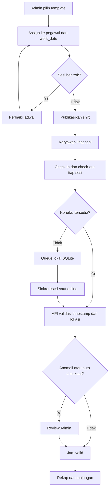
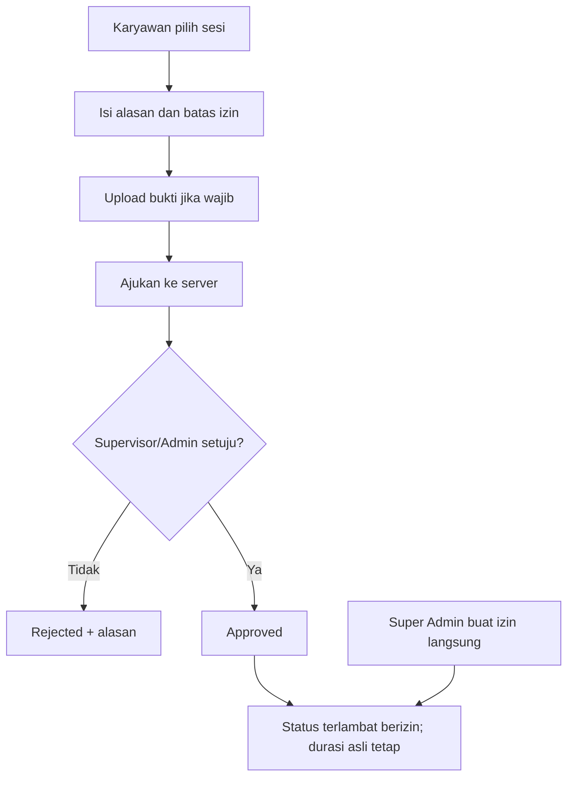
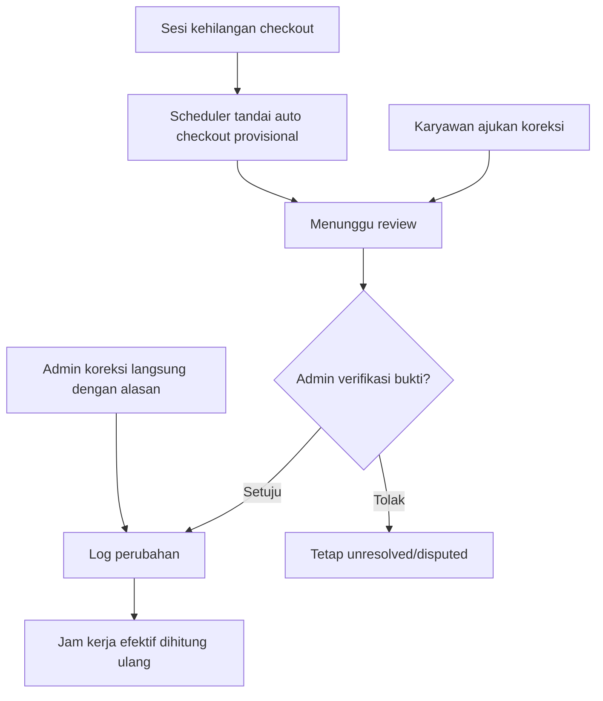
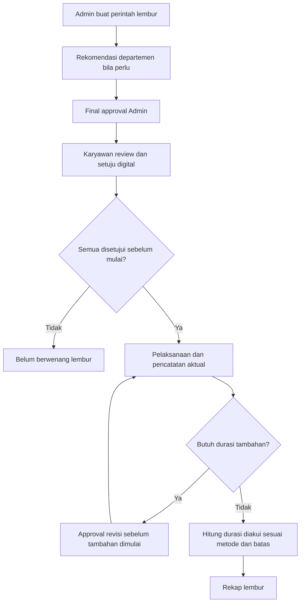
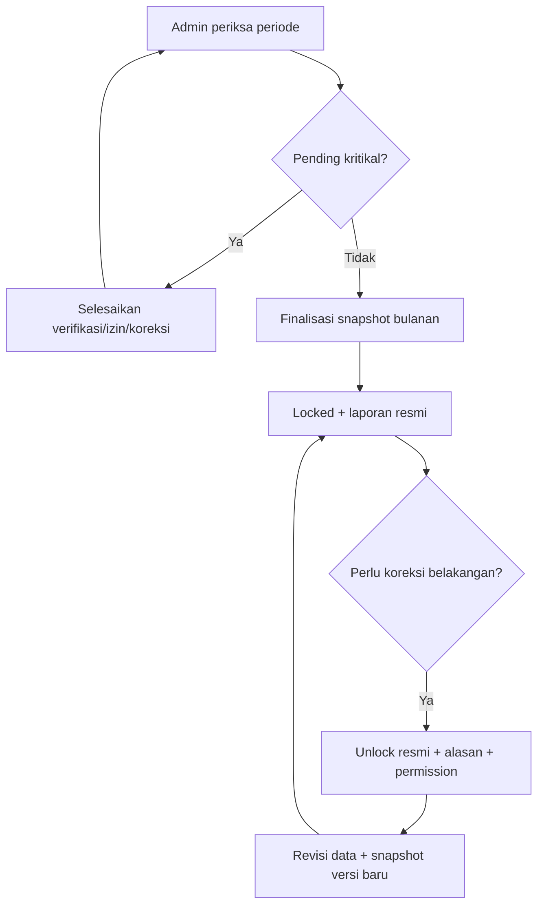
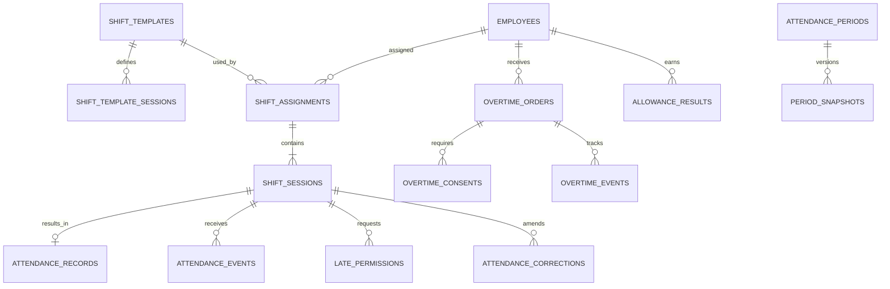

# PRODUCT REQUIREMENTS DOCUMENT (PRD)
## Sistem Absensi & Manajemen Shift Karyawan — Website + Mobile On-Premise

**Versi:** 1.1 — Baseline Tahap 1–5 (database disesuaikan menjadi MySQL 8.4 LTS)  
**Tanggal:** 24 Oktober 2026  
**Status:** Baseline kebutuhan disepakati; parameter operasional bertanda `[KONFIGURASI/TBD]` ditetapkan saat UAT/implementasi.  
**Target:** Satu perusahaan/lokasi awal, <50 karyawan, dapat dikembangkan tanpa arsitektur multi-tenant.  
**Stack:** Laravel (web + API), Expo/React Native (mobile), **MySQL 8.4 LTS (InnoDB)**, server fisik milik klien.  

---

## 1. Tujuan dan hasil yang harus dicapai

Membangun sistem absensi operasional terpusat yang dapat mengelola shift reguler dan shift khusus dengan 1–4 sesi per hari kerja, pencatatan check-in/out per sesi, izin keterlambatan, koreksi, lembur berbasis perintah admin dan persetujuan digital karyawan, tunjangan berbasis kehadiran, serta rekap terverifikasi yang bisa diekspor ke Excel dan PDF.

**Indikator keberhasilan:**
1. HRD dapat membuat jadwal untuk seluruh karyawan dari template maupun penyesuaian manual.
2. Aplikasi mobile hanya menampilkan sesi yang tepat dan mencegah absensi ganda.
3. Sesi 22:00–06:00 tercatat dalam satu tanggal kerja induk tanpa merusak total durasi.
4. Jam kerja valid tidak menggabungkan jeda antarsesi atau auto check-out yang belum diverifikasi.
5. Persetujuan izin, koreksi, dan lembur dapat dilacak sampai aktor, waktu, dan alasan.
6. Rekap per karyawan, departemen, dan perusahaan konsisten dengan detail sesi yang terkunci pada periode final.
7. Web dan API berjalan di server lokal klien, dapat diakses melalui LAN dan internet publik yang diamankan.
8. Absensi offline tersinkronisasi tanpa duplikasi dan kasus anomali dapat ditinjau admin.

## 2. Hasil keputusan Interview Tahap 1–5

### Tahap 1 — Lingkup & operasional
- <50 karyawan; satu lokasi awal, tetapi lokasi kerja memiliki mode `tanpa validasi GPS` atau `radius GPS`.
- Sesi kerja wajib mempunyai check-in dan check-out sendiri; 1–4 sesi/hari.
- Jadwal dibuat menggunakan template berulang dan perubahan manual.
- Interaksi utama mobile berupa tombol absen; tidak ada kewajiban selfie atau QR.
- Akses aplikasi via jaringan internal/LAN dan internet publik.
- Absensi dapat ditampung offline lalu disinkronkan.
- Server dan data berada di infrastruktur klien, tidak menggunakan VPS/cloud hosting aplikasi.

### Tahap 2 — Shift & keterlambatan
- Template shift dan penyesuaian manual jam/sesi.
- Shift dapat melintasi tengah malam, contohnya 22:00–06:00.
- Toleransi terlambat: global, bisa ditimpa kebijakan departemen/karyawan.
- Keterlambatan aktual dihitung dari jam jadwal semula. Misal jadwal 08:00, datang 08:15, terlambat aktual **15 menit**, meskipun toleransi 10 menit.
- Check-out yang terlupa ditutup sistem pada jam jadwal dengan status khusus, **belum sah sebagai jam kerja valid** sampai verifikasi Admin.
- Jadwal dapat diubah bebas sebelum sesi mulai; setelah mulai memakai proses koreksi yang terlacak.

### Tahap 3 — Izin dan koreksi
- Karyawan dapat meminta izin terlambat sebelum/ sesudah jadwal dengan batas pengajuan terkonfigurasi.
- Persetujuan izin oleh Supervisor/Admin-HRD berdasar kewenangan.
- **Penetapan izin terlambat langsung tanpa permintaan karyawan hanya boleh dilakukan Super Admin.**
- Batas izin telat bisa berupa target jam hadir atau durasi dalam menit.
- Durasi terlambat asli tidak hilang meskipun izin disetujui; status tetap `TERLAMBAT_BERIZIN`.
- Karyawan dapat mengajukan koreksi; Admin dapat melakukan koreksi langsung, tetapi aktivitas masuk audit log.
- Dokumen pendukung opsional atau wajib sesuai tipe pengajuan dan aturan admin.

### Tahap 4 — Lembur & jam kerja
- **Hanya Admin** yang membuat perintah lembur (bukan karyawan).
- Rantai approval dapat ditetapkan per departemen; persetujuan akhir tetap Admin.
- Lembur dapat berlangsung sebelum, sesudah, di antara sesi, pada hari libur, dan melintasi tanggal (jika lolos validasi aturan).
- Admin memilih input `jam mulai + jam selesai` atau `jam mulai + durasi`.
- Metode realisasi/ pengakuan lembur dapat ditentukan Admin per perintah. Simpan jadwal, realisasi, dan jam diakui secara terpisah.
- Perpanjangan lembur harus disetujui **sebelum** tambahan waktu dimulai; kelebihan tanpa persetujuan tidak diakui sebagai lembur.
- Jam kerja reguler dihitung sebagai penjumlahan jam kerja per sesi yang sah, **tanpa jeda antarsesi**.
- Status harian dapat `HADIR_SEBAGIAN`, misalnya 3 dari 4 sesi hadir.
- Jenis shift: reguler (misalnya 8 jam kerja/hari) dan khusus (misalnya 3 jam/sesi × 2–3 sesi pada hari yang sama). Durasi jam kerja **tidak diasumsikan selalu 8 jam**.

### Tahap 5 — Laporan, tunjangan & infrastruktur
- Dashboard, laporan Excel dan PDF; detail per orang, lintas karyawan, dan total durasi kerja agregat.
- Auto check-out masuk rekap **sementara**; jam kerja tervalidasi setelah Admin memverifikasi.
- Rekap bulanan difinalisasi/dikunci; revisi pasca-final membutuhkan pembukaan/koreksi berwenang.
- Tunjangan transport, makan, dll ditentukan dengan aturan yang dapat dikonfigurasi (kehadiran sesi, minimum jam, penuh/proporsional/tidak layak).
- Karyawan wajib menyatakan persetujuan digital terhadap perintah lembur sebelum melaksanakannya.
- Data absensi offline diproses otomatis; anomali jam, lokasi, dan duplikasi memerlukan review Admin.
- Login dengan rate limit, role/permission, dan audit trail untuk Admin.
- **Backup manual** oleh IT klien, bukan backup otomatis sebagai kebutuhan wajib.
- Server fisik sudah tersedia dan akses internet publik tersedia; spesifikasi dan konfigurasi akses perlu diverifikasi saat deployment.
- IT klien bertanggung jawab atas operasi server; vendor menangani dukungan aplikasi.

## 3. Pemeriksaan konflik & interpretasi mengikat

| Potensi ambiguitas | Keputusan arsitektur/bisnis |
|---|---|
| “Tombol saja” vs GPS radius opsional | Tombol tetap check-in/out; GPS merupakan validator tambahan **hanya ketika lokasi/policy mengaktifkannya**. Tidak wajib selfie. |
| Reguler 8 jam vs khusus 2–4 sesi | Satu mesin sesi; reguler bisa 1 sesi dengan istirahat yang tidak dibayar, khusus berisi 2–4 sesi check-in/out terpisah. |
| Check-out otomatis vs durasi kerja akurat | `auto_checkout_at` bukan `actual_checkout_at`. Durasi dihitung sebagai provisional dan tidak masuk jam kerja *valid* hingga verifikasi Admin. |
| Izin langsung hanya Super Admin vs koreksi langsung Admin | Dua izin akses berbeda: `late_permission.create_direct` (Super Admin) dan `attendance.correction.direct` (Admin yang ditunjuk); direct correction tak boleh diam-diam memalsukan persetujuan izin telat. |
| Offline vs approval wajib | Absen bisa diantrikan offline, tetapi tindakan izin/approval/lembur sah setelah diterima dan diputuskan server. Perintah lembur dan persetujuan digital harus sudah tercatat sebelum waktu mulai lembur. |
| Metode durasi lembur fleksibel vs kepatuhan | Metode hanya memengaruhi *durasi diakui* menurut aturan internal; realisasi faktual tetap tersimpan. Jangan mengakui durasi di luar jendela yang telah disetujui tanpa perpanjangan. Validasi ketentuan ketenagakerjaan. |
| Akses LAN + publik dengan server lokal | Layanan aplikasi tetap on-premise, hanya endpoint HTTPS dipublikasikan. Gunakan domain, TLS, firewall, rate limiting, dan idealnya reverse proxy/DMZ. Jangan membuka port MySQL **3306** ke internet. |
| Backup manual | Sistem menyediakan panduan/skrip backup manual dan verifikasi hasil; RPO mengikuti tanggal backup terakhir, sehingga risiko kehilangan data harus diterima klien. |

## 4. Aktor & tanggung jawab

- **Super Admin**: pengaturan organisasi, lokasi, akses, policy, pembukaan periode; satu-satunya yang dapat membuat izin terlambat langsung.
- **Admin/HRD**: master karyawan, shift, koreksi langsung, verifikasi auto check-out, pembuatan dan keputusan akhir lembur, laporan, finalisasi periode sesuai izin.
- **Supervisor**: lihat karyawan dalam tim, merekomendasikan/menyetujui izin telat bila didelegasikan, memberi rekomendasi lembur sebelum keputusan akhir Admin.
- **Employee**: lihat jadwal, check-in/out, ajukan izin telat, ajukan koreksi, setujui/tolak perintah lembur, lihat riwayat sendiri.
- **Auditor (opsional role konfigurasi)**: baca laporan & log, tanpa akses edit.
- **IT Klien (role teknis terpisah, bukan otomatis HRD)**: OS/server, jaringan, database operations, backup/restore sesuai SOP; tidak otomatis boleh memodifikasi absensi melalui UI.

Jabatan (Satpam, Finance, dll) dan departemen adalah data kepegawaian; tidak identik dengan role aplikasi. Pengguna bisa memiliki lebih dari satu peran sesuai scope penugasan.

### Matriks permission minimum

| Aksi | Super Admin | Admin/HRD | Supervisor | Karyawan | Auditor |
|---|:---:|:---:|:---:|:---:|:---:|
| Kelola karyawan & jabatan | ✓ | ✓ | — | — | — |
| Atur global/override policy | ✓ | ✓ sesuai delegasi | — | — | — |
| Atur/publikasi jadwal | ✓ | ✓ | ◇ delegasi | — | — |
| Check-in/out sesi sendiri | — | ◇ bila berstatus karyawan | ◇ bila berstatus karyawan | ✓ | — |
| Ajukan izin telat | ◇ | ◇ | ◇ | ✓ | — |
| Approval izin tim | ✓ | ✓ | ◇ berdasarkan scope | — | — |
| Buat izin terlambat langsung | ✓ | — | — | — | — |
| Ajukan koreksi sendiri | ◇ | ◇ | ◇ | ✓ | — |
| Koreksi data secara langsung | ✓ | ✓ | — | — | — |
| Verifikasi auto check-out | ✓ | ✓ | — | — | — |
| Buat perintah lembur | ✓ | ✓ | — | — | — |
| Rekomendasi lembur | ✓ | ✓ | ◇ departemen | — | — |
| Final approval perintah lembur | ✓ | ✓ | — | — | — |
| Persetujuan digital karyawan lembur | — | — | — | ✓ atas perintah sendiri | — |
| Finalisasi rekap | ✓ | ✓ ditugaskan | — | — | — |
| Buka ulang rekap terkunci | ✓ | ◇ jika diberi kewenangan eksplisit | — | — | — |
| Laporan semua karyawan | ✓ | ✓ | ◇ tim sendiri | — | ✓ |
| Laporan diri sendiri | ✓ | ✓ | ✓ | ✓ | ✓ |

`◇` = tergantung delegasi/pegawai juga memegang role Employee. Permission harus ditegakkan di backend, bukan hanya menyembunyikan tombol UI. Hindari self-approval untuk transaksi milik diri sendiri (kecuali kebijakan khusus yang disetujui pimpinan).

## 5. Kebutuhan fungsional per modul

### M01 — Akun, organisasi, role & akses (MUST)
- Login web dengan session + CSRF; login mobile melalui token API per perangkat.
- Reset password oleh admin/flow internal; nonaktifkan akun pegawai keluar.
- Login Admin dan Super Admin memakai email dan password dengan rate limit; tidak ada challenge atau kode pemulihan 2FA.
- Permission dan data scope departemen; semua write dilog.
- Session/token dapat dicabut bila perangkat hilang; pembatasan percobaan login.

**Acceptance:** Employee tidak bisa melihat rincian karyawan lain melalui manipulasi URL/API; akun staf yang tidak terautentikasi ditolak sebelum masuk ke halaman admin.

### M02 — Master kepegawaian & lokasi (MUST)
- Employee: ID internal unik, nama, jabatan, departemen, tanggal aktif/nonaktif, status, akun.
- Satu lokasi awal; bisa memiliki beberapa titik radius di kemudian hari, tetapi bukan fitur multi-cabang lengkap.
- Mode lokasi per lokasi/policy: `NONE` atau `RADIUS` (koordinat, radius meter, akurasi maksimum); log metadata GPS hanya bila relevan.
- Penempatan departemen efektif bertanggal agar riwayat terjaga.

**Acceptance:** Aturan radius nonaktif tidak meminta izin GPS; ketika aktif, aplikasi meminta izin dan menolak atau menandai tidak valid sesuai kebijakan saat radius/akurasi gagal.

### M03 — Shift templates & penugasan (MUST)
- Jenis shift `REGULAR` dan `SPECIAL`; template dengan 1–4 sesi.
- Sesi: urutan, jam mulai/akhir, aturan lokasi, jenis jam kerja, istirahat tidak dihitung.
- Template berulang mingguan + copy jadwal + override manual individu/tanggal.
- Setiap penugasan memiliki `work_date` lokal; sesi lintas tengah malam memakai timestamp tanggal lengkap.
- Validasi duplikat dan bentrok **waktu aktual** termasuk sesi antartanggal kerja.
- Lock perubahan jadwal saat sesi mulai; perubahan sesudahnya menjadi request amendment/correction dengan audit.
- Tampilkan status jadwal: DRAFT, PUBLISHED, IN_PROGRESS, COMPLETED, CANCELLED.

**Acceptance:** Template 08:00–17:00 dengan istirahat 1 jam menghasilkan 8 jam terjadwal; 06:00–09:00 + 12:00–15:00 menghasilkan 6 jam dan dua kewajiban check-in/out.

### M04 — Absensi online/offline per sesi (MUST)
- Check-in/out per `shift_session_id`, bukan per hari; satu pasangan per sesi kecuali koreksi beralasan.
- Waktu online berasal dari server. Device timestamp tetap dicatat sebagai metadata diagnostik.
- Offline event dibuat dengan UUID idempotency, waktu perangkat, zona waktu, data lokasi (jika aktif), perangkat, sync status, dan nomor urutan lokal.
- Antrian offline disimpan secara persisten di SQLite; saat koneksi kembali, kirim berurutan dengan retry dan backoff; server deduplikasi UUID.
- Server menguji jendela sesi, status jadwal, radius/akurasi, duplikasi, perubahan jam perangkat, dan gap sync; kasus mencurigakan `REVIEW_REQUIRED`.
- Jika karyawan lupa checkout: scheduler membuat penutupan provisional pada jam akhir jadwal, **bukan checkout aktual**; masuk antrean verifikasi Admin.
- Jika event offline checkout kemudian datang setelah auto checkout, server melakukan rekonsiliasi, mempertahankan jejak peristiwa mentah, dan menghindari durasi ganda.

**Acceptance:** Kirim satu event offline tiga kali menghasilkan satu transaksi absensi; auto check-out tidak meningkatkan jam tervalidasi sebelum review.

### M05 — Kebijakan hadir, toleransi & status (MUST)
- Policy global, override departemen, override individu; prioritas: `INDIVIDUAL > DEPARTMENT > GLOBAL`.
- Parameter minimal: grace late, earliest check-in, latest permitted check-in, grace early checkout, batas request izin, waktu auto checkout, persyaratan validasi GPS, bukti wajib menurut jenis permintaan.
- Catat snapshot policy versi efektif di sesi supaya rekap sejarah tetap deterministik.
- `raw_late_minutes = max(0, actual_check_in - scheduled_start)`; `is_late` berdasarkan lewatnya grace, tetapi menit yang dilaporkan tetap menit asli.
- `regular_verified_minutes` = total interval kehadiran yang tervalidasi dipotong window sesi yang relevan dan istirahat tak dibayar; jangan menggandakan interval atau memasukkan overtime secara otomatis.

**Acceptance:** Jadwal 08:00, grace 10, check-in 08:15 => `is_late=true`, `raw_late_minutes=15`.

### M06 — Izin terlambat & approval (MUST)
- Employee pilih sesi yang belum/sudah lewat, alasan, jam target atau durasi izin, bukti sesuai policy.
- Limit waktu pengajuan `[KONFIGURASI/TBD]`; permintaan di luar batas ditolak/diarahkan eskalasi sesuai policy.
- Routing Supervisor atau Admin/HRD berdasarkan departemen dan kewenangan.
- Super Admin saja dapat membuat izin langsung tanpa request employee; alasan wajib dan audit khusus.
- Status: DRAFT, PENDING, APPROVED, REJECTED, CANCELLED.
- Izin tidak mengubah cap waktu/check-in asli; laporan memisahkan terlambat dengan dan tanpa izin.

### M07 — Koreksi dan verifikasi kehadiran (MUST)
- Employee mengajukan koreksi check-in/out per sesi dengan alasan dan bukti jika diwajibkan.
- Admin dapat memutus permintaan dan juga melakukan koreksi langsung dengan alasan wajib.
- Data event asli immutable; simpan before/after, pelaku, reviewer, alasan, waktu, bukti.
- Verifikasi auto check-out menegaskan/menyesuaikan akhir sesi berdasarkan bukti; tidak boleh otomatis menganggap jadwal selesai sebagai jam valid.
- Jika rekap periode sudah final, pengajuan koreksi ditahan dan hanya dapat diterapkan melalui proses unlock/revision yang terekam.

### M08 — Perintah lembur & persetujuan digital (MUST)
- Hanya Admin/HRD/Super Admin berwenang membuat lembur; Employee tidak punya endpoint membuat perintah.
- Departemen dapat memilih chain rekomendasi, tetapi persetujuan akhir oleh Admin.
- Admin input waktu mulai/akhir **atau** mulai/durasi; persetujuan akhir berisi window dan maksimum durasi yang eksplisit.
- Setelah perintah disetujui Admin, Employee harus menandatangani persetujuan digital yang mengikat akun, device, timestamp server, versi isi perintah, dan hash data persetujuan.
- Overtime baru berstatus `AUTHORIZED` jika **approval admin + consent employee** lengkap sebelum mulai.
- Check-in/out pelaksanaan lembur dapat memakai event terpisah dari sesi reguler; overlapping dengan jam reguler tidak dihitung dua kali.
- Metode perintah: `ACTUAL_CAPPED` (berdasar realisasi dalam window disetujui) atau `PLANNED_CAPPED` (berdasar durasi rencana setelah pelaksanaan dikonfirmasi Admin). Nilai aktual selalu disimpan. Metode dan kebijakan tidak boleh mengakui overtime sebelum pelaksanaan atau di luar jendela tanpa approval tambahan.
- Perpanjangan membuat revisi/perintah tambahan yang harus disetujui dan di-consent **sebelum segmen ekstra dimulai**. Waktu ekstra yang tidak disetujui tidak masuk `recognized_overtime_minutes`.
- Aturan batas/istirahat/lembur akhir pekan/hari libur dapat dikonfigurasi dan harus ditinjau terhadap ketentuan yang berlaku; catat pengecualian bila sektor tertentu memiliki aturan khusus.

### M09 — Tunjangan berbasis kehadiran (MUST)
- Master jenis: transport, makan, dan custom; besaran per periode/pegawai/kelompok `[KONFIGURASI/TBD]`.
- Rule eligibility: semua sesi wajib, minimal X dari Y sesi, minimal menit tervalidasi, atau kombinasi.
- Payout: FULL, PRORATED_BY_SESSION, PRORATED_BY_MINUTES, NONE; dapat diatur per tunjangan dan efektif bertanggal.
- Sesi provisional dan data review tidak dianggap valid untuk tunjangan final sampai disahkan.
- Untuk setiap hari/pegawai simpan input eligibility, rule version, nominal final, dan alasan; item yang ditolak harus terlihat.
- Modul ini **bukan full payroll** (tidak menghitung gaji pokok, PPh21, BPJS, dan transfer bank).

### M10 — Dashboard, laporan & finalisasi (MUST)
- Filter rentang tanggal, karyawan, departemen, jabatan, tipe shift, status, lokasi, keterlambatan, overtime.
- Dashboard: jumlah pegawai dijadwalkan/hadir/hadir sebagian/tidak hadir, jam reguler terjadwal, jam reguler valid, overtime diakui, pending izin, pending review, estimasi tunjangan.
- Detail per karyawan: semua sesi, waktu event mentah, waktu efektif, actual/verified minutes, late minutes, izin, correction, overtime, allowance.
- Agregat: total jam per karyawan, departemen, dan keseluruhan; hari hadir berbeda dari jumlah sesi hadir.
- Export Excel (.xlsx) dan PDF mengikuti filter dan kebijakan hak akses; sertakan tanggal generasi, status rekap, dan watermark provisional jika belum final.
- Finalisasi bulanan membuat snapshot periode & revision; tolak finalisasi jika masih ada event/review/approval kritikal yang belum selesai atau harus ada override eksplisit oleh Super Admin.
- Unlock/reopen harus beralasan, terbatas izin, membuat versi rekap baru dan audit; arsip versi terdahulu tetap bisa diakses.

### M11 — Konfigurasi, audit & administrasi on-premise (MUST)
- Pengaturan umum website mencakup nama, logo, favicon, dan kontak yang tampil di halaman login; semua role web admin dapat mengubahnya.
- Pengaturan operasional mencakup jam server, zona waktu, lokasi, holiday calendar, policy, login, dan rate limit.
- Audit event append-only pada aktivitas kritis, dengan metadata permintaan dan perubahan nilai.
- IT klien mendapat skrip/SOP backup manual MySQL (`mysqldump --single-transaction`) + file attachment dan pemulihan; hasil backup disimpan ke media fisik berbeda.
- Monitoring minimal: uptime, disk, error log, antrean job, kegagalan sinkronisasi.

## 6. Aturan perhitungan (normatif)

### 6.1 Unit waktu & tanggal
- Semua waktu kejadian absolut disimpan sebagai **UTC di kolom MySQL `DATETIME(6)`**; koneksi database dan aplikasi diset ke UTC. `DATETIME` tidak menyimpan informasi zona waktu sehingga konversi dilakukan di Laravel. `work_date` tetap bertipe `DATE`, sedangkan jam lokal template bertipe `TIME`. Tampilan jam dan pengelompokan hari memakai timezone lokasi/organisasi (awal `Asia/Jakarta`, configurable).
- `work_date` = tanggal awal kerja sebagaimana tertera pada penugasan, termasuk sesi selesai keesokan hari.
- Durasi dihitung berdasarkan instant timestamp, bukan mengurangkan string `HH:mm`.
- Nilai numerik disimpan dalam **menit integer**; pembulatan tampilan/jam pembayaran `[KONFIGURASI/TBD]`.

### 6.2 Definisi durasi
- `scheduled_regular_minutes`: jumlah menit sesi terjadwal dikurangi istirahat tidak dibayar.
- `actual_presence_minutes`: bukti waktu kedatangan hingga pulang menurut event yang tercatat (dapat sementara/offline).
- `verified_regular_minutes`: menit kehadiran yang telah tervalidasi dan dialokasikan ke sesi reguler; tidak termasuk jeda, tidak termasuk overlap, dan tidak termasuk lembur.
- `approved_overtime_minutes`: maksimum waktu lembur yang disetujui sesuai window.
- `actual_overtime_minutes`: realisasi nyata/tercatat yang telah direkonsiliasi.
- `recognized_overtime_minutes`: hasil metode perintah lembur yang sah, dibatasi window/otorisasi dan keputusan validasi.
- `total_recognized_work_minutes = verified_regular_minutes + recognized_overtime_minutes` (tanpa double count).

### 6.3 Contoh reguler & khusus
| Pola | Jadwal | Istirahat/Jeda | Terjadwal |
|---|---|---|---:|
| Reguler | 08:00–17:00 | istirahat 12:00–13:00, tidak dibayar | 480 menit |
| Khusus 2 sesi | 06:00–09:00; 15:00–18:00 | jeda antarsesi tidak dihitung | 360 menit |
| Khusus 3 sesi | 06:00–09:00; 12:00–15:00; 18:00–21:00 | jeda antarsesi tidak dihitung | 540 menit |

### 6.4 Tunjangan harian
Misal aturan transport Rp20.000/hari, minimum 2 sesi dan 300 menit valid; pegawai 3 sesi dijadwalkan, hadir 2 sesi dengan 360 menit valid. Jika policy `FULL`, hak = Rp20.000. Jika `PRORATED_BY_SESSION`, hak = Rp20.000 × 2/3 sesuai pembulatan kebijakan. Nominal, ambang dan metode tersebut hanyalah contoh, belum disetujui klien.

## 7. Workflow bisnis

### 7.1 Penjadwalan hingga absensi


### 7.2 Izin terlambat


### 7.3 Koreksi & auto checkout


### 7.4 Lembur


### 7.5 Penutupan bulan


## 8. Struktur database — MySQL 8.4 LTS (InnoDB)

### 8.1 Tabel inti
| Domain | Tabel | Kolom/relasi esensial |
|---|---|---|
| Auth | `users` | id, login, password_hash, active; relasi akun ke karyawan melalui `employees.user_id` |
| Auth | `roles`, `permissions`, `role_user`, `permission_role` | kontrol akses berbasis scope |
| Master | `departments`, `positions`, `work_locations`, `employees` | identity, relasi departemen, jabatan, lokasi, `employees.user_id` (UNIQUE nullable) |
| Policy | `attendance_policies` | id, scope_type, scope_id, priority, grace_min, GPS config, effective_from/to, version |
| Shift | `shift_templates` | id, type, name, repeat_pattern |
| Shift | `shift_template_sessions` | template_id, seq, local_start/end, day_offset, unpaid_break_minutes |
| Shift | `shift_assignments` | employee_id, work_date, template_id, status, published_at, version |
| Shift | `shift_sessions` | assignment_id, seq, start_at, end_at, policy_snapshot JSON, status |
| Absensi | `attendance_events` | id, session_id, event_uuid unique, device_id, event_type, device_at, received_at, source, GPS, validation flags |
| Absensi | `attendance_records` | session_id unique, in_event_id?, out_event_id?, actual_in_at?, actual_out_at?, provisional_out_at?, verification_status, actual_min, verified_min |
| Izin | `late_permissions` | session_id, requester_id?, direct_by?, reason, allowed_until, requested_minutes, status |
| Koreksi | `attendance_corrections` | session_id, request_by, apply_by, before_json, after_json, reason, status |
| Approval | `approval_steps`, `approval_actions` | domain_type/id, step, actor, decision, at, reason |
| Lembur | `overtime_orders` | employee_id, work_date, start_at, end_at, planned_min, method, status, final_admin_id |
| Lembur | `overtime_consents` | order_id, employee_id, accepted, consent_at, payload_hash, device_id |
| Lembur | `overtime_events`, `overtime_records` | check events, actual_min, recognized_min, verified_by |
| Tunjangan | `allowance_types`, `allowance_policies`, `allowance_results` | rate, eligibility rule, effective dates, per-employee-period result |
| Rekap | `attendance_periods`, `period_snapshots` | YYYY-MM, status, locked_at, revision, checksum, JSON summary/file ref |
| Audit | `audit_logs`, `sync_batches`, `device_registrations` | actor, verb, target, before_after, UUID, device identity, status |
| File | `attachments` | owner_type/id, file_path, mime, checksum, access control |

### 8.2 ERD inti (ringkas)


### 8.3 Konvensi khusus MySQL
- **Versi/engine:** MySQL 8.4 LTS dan seluruh tabel transaksi memakai `InnoDB`; charset `utf8mb4` dan collation yang konsisten (mis. `utf8mb4_0900_ai_ci`). Tidak memakai sintaks PostgreSQL seperti `timestamptz`, `jsonb`, exclusion constraint, `ON CONFLICT`, `ILIKE`, atau indeks GIN.
- **Waktu:** `DATETIME(6)` menyimpan nilai UTC yang ditulis/dibaca aplikasi; bukan `TIMESTAMP`, supaya rancangan tidak terikat batas tahun 2038 milik `TIMESTAMP` MySQL. Tetapkan `APP_TIMEZONE=UTC` dan timezone sesi koneksi `+00:00`; simpan ID zona kerja (`Asia/Jakarta`) untuk konversi jadwal lokal/lintas hari.
- **Jenis data:** Laravel `$table->id()` (`BIGINT UNSIGNED`), `$table->foreignId()->constrained()`, `$table->json()` untuk snapshot/payload, `$table->uuid('event_uuid')->unique()` untuk deduplikasi; durasi `unsignedInteger` menit, nominal rupiah `BIGINT` bila bilangan bulat.
- **Index:** unique pada `event_uuid`, `(employee_id, work_date)`, `(assignment_id, sequence)`, dan `attendance_records.shift_session_id`; indeks gabungan pada filter laporan dan pemrosesan sinkronisasi. Hindari menyimpan kolom utama yang selalu difilter hanya di dalam JSON.
- **Konsistensi:** `DB::transaction()` + `lockForUpdate()` pada baris induk karyawan/sesi sebelum memeriksa jadwal bertabrakan, perubahan attendance projection, approval, dan finalisasi bulan. `UNIQUE` pada database tetap wajib; validasi aplikasi saja tidak cukup. Tangani deadlock dengan retry transaksi terbatas.
- **Offline:** UUID sama dengan payload identik mengembalikan hasil sebelumnya; UUID sama dengan payload berbeda mengembalikan HTTP `409`, tanpa mengubah event asli. Simpan hash payload kanonik bila dibutuhkan untuk memeriksa kesamaan event.
- **Backup:** `mysqldump --single-transaction` untuk data InnoDB ditambah direktori attachment dan secrets terenkripsi; eksekusi manual oleh IT klien, dengan uji restore. Jangan pernah membuka port MySQL 3306 ke internet.

### 8.4 Integritas data dan indeks
- `attendance_events.event_uuid` unique dan `attendance_records.shift_session_id` unique.
- `shift_sessions (assignment_id, seq)` unique; `shift_assignments (employee_id, work_date)` unique pada desain satu assignment per tanggal kerja.
- Index pada `(employee_id, work_date)`, `(start_at, end_at)`, `(session_id, received_at)`, `(status, period)` sesuai pola query.
- Idempotency juga berlaku di API koreksi dan approval untuk mencegah double submit.
- Larang sesi overlap per karyawan dengan pemeriksaan di dalam transaksi dan `lockForUpdate()` pada `employees`, mengunci baris yang **pasti ada** sebelum membaca/mengubah jadwal. MySQL tidak memiliki PostgreSQL exclusion constraint; constraint UNIQUE menangani duplikat, pemeriksaan overlap harus dilakukan oleh aplikasi di bawah lock.
- Log raw check-in/out tidak dimodifikasi dan tidak dihapus dari aplikasi reguler; correction membentuk versi efektif.

## 9. Arsitektur teknis

### 9.1 Komponen
- **Laravel modular monolith**: web admin Blade + komponen UI seperlunya; REST API v1 untuk Expo; use case modules di domain aplikasi tunggal (hindari microservices).
- **Laravel Sanctum**: session cookie untuk website, token per device untuk mobile.
- **MySQL 8.4 LTS / InnoDB**: satu database pada server klien; akses hanya loopback/private.
- **Nginx + PHP-FPM**: front web dan API HTTPS.
- **Laravel Queue** dengan database driver untuk kebutuhan <50 pegawai; supervisor systemd untuk worker; scheduler cron untuk job regular (auto checkout, rekap, housekeeping).
- **File storage lokal** untuk dokumen izin/koreksi & ekspor. Akses melalui aplikasi setelah permission check; jangan publikkan folder bukti.
- **Expo + React Native + TypeScript**: mobile; `expo-sqlite` sebagai antrian offline, `expo-secure-store` untuk token, lokasi diminta hanya ketika policy mengaktifkan GPS.
- **One repository / monorepo sederhana** disarankan: `server/` Laravel dan `mobile/` Expo. Berbagi spesifikasi API OpenAPI, bukan menambah backend terpisah.

### 9.2 Topologi
```text
Android/iOS Expo ── HTTPS/LAN atau internet ─┐
                                            ├── Firewall/Reverse Proxy (TLS)
Browser Admin ── HTTPS/LAN atau internet ───┘          │
                                                     Nginx
                                                       │
                                        Laravel (web + REST API + jobs)
                                               │           │
                                          MySQL     Local files
                                               └────┬──────┘
                                            Backup MANUAL
                                             (IT klien)
```

**Catatan penting on-premise:** Akses publik tidak berarti hosting cloud. Namun klien tetap harus menyediakan domain/FQDN dan sertifikat TLS, konfigurasi router/firewall/NAT atau reverse proxy, alamat IP yang dapat dijangkau, serta DNS internal yang sesuai untuk akses LAN. Jangan ekspos database, worker, atau port administrasi ke internet. Jika kantor kehilangan internet tetapi LAN aktif, web lokal dapat tetap berfungsi selama alamat internal/DNS/TLS disiapkan dengan benar.

### 9.3 Model sinkronisasi offline
1. App yang sudah login mengambil jadwal/policy terbaru dan menyimpannya lokal.
2. Ketika offline, check-in/out dibuat sebagai immutable local event dengan UUID, waktu perangkat, ID sesi, dan koordinat hanya jika diperlukan; tampil `Menunggu Sinkronisasi`.
3. Saat online, app mengirim batch berurut. Backend menyimpan event mentah sekali; mengecek token/device, assignment, radius, keterlambatan sinkronisasi, dan duplikasi.
4. Event valid diproyeksikan menjadi attendance record. Event mencurigakan tetap disimpan sebagai evidence dan masuk review Admin; tidak dihapus diam-diam.
5. Karyawan melihat tiga status berbeda: `Tersimpan di perangkat`, `Tersinkronisasi`, `Tervalidasi` atau `Butuh tinjauan`.
6. Jam perangkat **tidak bisa dibuktikan sepenuhnya** ketika lama offline; batas maksimum offline dan perlakuan terhadap perubahan waktu perangkat adalah parameter policy `[TBD]`.
7. Tidak menjanjikan anti-fraud 100%; GPS bisa dipalsukan dan offline clock bisa dimanipulasi, sehingga audit/anomaly workflow wajib.

### 9.4 Dependensi pihak ketiga
- Login admin memakai email/password dan rate limit; implementasi tidak menggunakan layanan autentikasi 2FA pihak ketiga.
- Push notification lintas internet dapat membutuhkan layanan pihak ketiga; **tidak masuk kebutuhan wajib**. Status penting ditampilkan di dalam web/mobile saat tersambung ke server. Jika kelak diminta push, evaluasi layanan dan kebijakan data terpisah.
- Android internal APK dapat didistribusikan melalui kanal perusahaan dengan signing key; penentuan iOS distribution/program Apple harus ditetapkan jika iOS masuk cakupan implementasi.

## 10. API contract awal

Semua endpoint kecuali auth di bawah `/api/v1`, HTTPS, autentikasi + authorization server-side, pagination dan validation.

| Method | Endpoint | Fungsi |
|---|---|---|
| POST | `/auth/login` | login + pendaftaran perangkat, token |
| POST | `/auth/logout` | revoke token |
| GET | `/me` | profil + permission + cakupan |
| GET | `/me/schedule?from=&to=` | daftar shift/sesi sendiri dan policy aktif |
| POST | `/attendance/events` | check-in/out idempotent (online atau sync) |
| POST | `/attendance/sync` | batch offline events; hasil per event |
| GET | `/attendance/me?from=&to=` | riwayat dan status validasi |
| POST | `/late-permissions` | buat pengajuan izin telat |
| GET | `/late-permissions` | daftar sesuai hak akses |
| POST | `/late-permissions/{id}/decision` | approve/reject oleh aktor berwenang |
| POST | `/late-permissions/direct` | hanya Super Admin |
| POST | `/attendance-corrections` | ajukan koreksi |
| POST | `/attendance-corrections/{id}/decision` | putuskan koreksi |
| POST | `/attendance/records/{id}/verify` | verifikasi auto checkout |
| GET | `/overtime/orders` | daftar perintah lembur |
| POST | `/overtime/orders/{id}/consent` | setuju/tolak dengan bukti digital |
| POST | `/overtime/events` | event pelaksanaan lembur |
| GET | `/reports/attendance` | agregat terotorisasi |
| GET | `/reports/attendance/export?format=xlsx|pdf` | ekspor |
| POST | `/periods/{id}/finalize` | finalisasi rekap |
| POST | `/periods/{id}/reopen` | pembukaan resmi oleh aktor berwenang |

Endpoint admin master-data/shift/allowance melalui route web `admin/*` atau API v1 terpisah sesuai kebutuhan frontend. Semua perubahan status approval ditolak bila tidak memenuhi urutan, waktu, atau hak akses.

## 11. UX / daftar halaman

### Web Admin
1. Login email dan password
2. Dashboard harian dan pending actions
3. Master karyawan, departemen, jabatan, akun, role
4. Lokasi kerja & attendance policy
5. Template shift & kalender penjadwalan
6. Monitoring attendance live/per sesi + offline anomalies
7. Kotak masuk izin terlambat + direct permission Super Admin
8. Koreksi & verifikasi auto checkout
9. Perintah lembur, chain approval, consent dan realisasi
10. Tunjangan dan kebijakan eligibility
11. Laporan detail, rekap bulanan, ekspor
12. Finalisasi/revisi periode & audit log
13. Pengaturan sistem & halaman panduan backup/operasi

### Mobile Employee
1. Login
2. Home hari ini: timeline 1–4 sesi, status online/offline
3. Tombol check-in/out untuk sesi yang relevan + indikator status sinkronisasi
4. Kalender jadwal
5. Riwayat absensi dan total jam valid
6. Pengajuan/riwayat izin terlambat
7. Pengajuan/riwayat koreksi
8. Perintah lembur, detail durasi, setuju/tolak digital, status pelaksanaan
9. Profil dan logout

### Mobile Supervisor (jika memiliki role)
- Dashboard approval izin departemen dan jadwal tim, terbatas pada data kewenangan; fungsi admin penuh tetap di web.

## 12. Prioritas pembangunan & pembagian modul

| Fase | Modul | Dependensi | Output selesai |
|---|---|---|---|
| F1: Foundation | M01–M03 | Infrastruktur dev, policy awal | Master, RBAC, shift reguler/khusus + publish |
| F2: Attendance | M04–M05 | F1 | Expo login, online/offline, validasi GPS opsional, sesi dan jam valid |
| F3: Approval & Overtime | M06–M08 | F2 | Izin, koreksi, auto checkout review, lembur consent |
| F4: Allowance & Reports | M09–M10 | F3 | Tunjangan, agregat, ekspor, lock/revision |
| F5: On-prem & UAT | M11 + hardening | F1–F4 | Deployment lokal, security test, backup/restore runbook, UAT |

**Pembagian tim sederhana:** Backend Laravel menangani schema, aturan, API, web admin. Mobile Expo menangani UI dan SQLite sync. QA/PM mengelola skenario UAT, kebijakan, dan integrasi; integrasi lewat OpenAPI dan staging LAN yang bisa diakses keduanya. Tidak perlu memecah microservice untuk <50 pegawai.

## 13. UAT / acceptance criteria wajib

- **UAT-01**: Shift reguler 08:00–17:00 dengan 60 menit istirahat = 480 menit terjadwal.
- **UAT-02**: Shift khusus tiga sesi × 180 menit = 540 menit, tiga pasang check-in/out independen.
- **UAT-03**: 4 sesi dijadwalkan, 3 hadir => status `HADIR_SEBAGIAN`, jumlah hadir 3/4, tidak dihitung 3 hari hadir.
- **UAT-04**: Shift 22:00–06:00 selesai hari berikutnya dan tetap termasuk tanggal kerja awal.
- **UAT-05**: Kebijakan grace 10 menit, datang +15 menit => terlambat aktual 15 menit.
- **UAT-06**: Employee override grace mengalahkan department dan global, snapshot history tidak berubah jika setting diganti.
- **UAT-07**: Tanpa mode GPS, aplikasi tidak meminta izin lokasi; mode radius wajib menguji radius dan akurasi.
- **UAT-08**: Dua kali kirim event UUID sama (retries) tidak menggandakan absensi; event offline out-of-order tertangani deterministik.
- **UAT-09**: Event offline dengan clock drift/fake position mencurigakan masuk review, tidak otomatis dianggap sah.
- **UAT-10**: Auto check-out membuat status provisional dan `verified_minutes` belum dihitung tanpa verifikasi Admin.
- **UAT-11**: Hanya Super Admin dapat membuat izin telat langsung; Admin/HRD mendapat HTTP 403 pada endpoint tersebut.
- **UAT-12**: Employee dapat mengajukan izin/koreksi; Supervisor hanya melihat tim dengan scope yang benar.
- **UAT-13**: Koreksi langsung Admin menghasilkan audit before/after dan tidak menghapus event mentah.
- **UAT-14**: Employee tidak dapat membuat perintah lembur; Admin membuat dan memberi approval akhir.
- **UAT-15**: Consent digital Employee sebelum lembur wajib; perintah tanpa consent tidak berstatus authorized.
- **UAT-16**: Overtime tidak terhitung dua kali dengan jam reguler; tambahan di luar batas tidak diakui tanpa perpanjangan terlebih dahulu.
- **UAT-17**: Metode lembur berbeda per perintah menghasilkan `actual_minutes` dan `recognized_minutes` terpisah.
- **UAT-18**: Tunjangan FULL/PRORATED/NONE bekerja berdasar sesi valid dan minimum menit, bukan sesi provisional.
- **UAT-19**: Rekap individual, departemen, agregat bulanan, Excel, PDF konsisten angka dan filter.
- **UAT-20**: Periode dikunci tidak dapat berubah oleh tindakan biasa; reopen berizin membuat revision + audit.
- **UAT-21**: Endpoint tak terotorisasi ditolak meski URL diketahui; akun staf nonaktif tidak dapat login.
- **UAT-22**: Mobile tersambung baik via LAN maupun HTTPS publik. Database tidak terbuka publik.
- **UAT-23**: IT klien dapat membuat backup manual dan melakukan uji restore ke lingkungan test.
- **UAT-24**: Saat internet kantor mati tetapi LAN masih aktif, operasional lokal berjalan jika LAN/DNS/TLS mendukungnya; mobile di luar LAN menggunakan offline queue.

## 14. Persyaratan non-fungsional & keamanan

- **Keamanan:** HTTPS TLS, no public DB, firewall least-privilege, login throttle, validasi permission server side, API rate limit, anti-CSRF untuk web, secret di environment server, audit trail, pembatasan akses attachment.
- **Reliability:** durasi valid dihitung ulang secara idempotent; transaksi persetujuan atomic; job dapat di-retry; auto checkout hanya provisional.
- **Kinerja target awal (harus diuji di hardware klien):** operasi absensi online tidak harus melakukan query agregat berat; gunakan pagination untuk daftar besar, index efektif, laporan berat via background job bila perlu.
- **Observability:** rotasi log, endpoint health, status job/retries, sync failures; error tidak membocorkan informasi rahasia.
- **Keberlanjutan:** migration versioned, dependency lockfiles, build mobile ditandatangani, staging untuk uji sebelum production.
- **Privasi:** minimisasi penyimpanan GPS (hanya saat mode radius aktif), retensi data dan hak akses ditetapkan klien sesuai kewajiban hukum yang berlaku.
- **Backup manual:** klien menerima risiko RPO bergantung backup terakhir; SOP perlu meliputi database + lampiran + secrets secara aman, checksum, penyimpanan off-server, dan uji restore berkala meskipun jadwal backup otomatis tidak diaktifkan.

## 15. Deployment on-premise & serah-terima

1. **Survey** CPU/RAM/storage/OS server eksisting, status UPS, jaringan LAN, public IP/domain, NAT, firewall, sertifikat, akses IT dan kebijakan update.
2. **Prepare** Ubuntu LTS (atau OS server yang disepakati), akses SSH melalui VPN/allowlist, non-root deploy user, update, firewall, Nginx, PHP-FPM, MySQL Server 8.4 LTS (InnoDB), supervisor, cron.
3. **Release backend** kode versi tertentu, environment secret, migrasi database, storage privat untuk bukti, `php artisan storage:link` untuk logo/favicon publik, konfigurasi queue scheduler, aplikasi web dan API satu origin jika memungkinkan.
4. **TLS dan akses** terapkan HTTPS untuk LAN dan publik dengan hostname konsisten, uji DNS internal/split-horizon bila perlu. Jangan forwarding port database ke internet.
5. **Mobile** produksi APK Android bertanda tangan via local build jika Android scope. iOS memerlukan build/signing/distribusi sesuai program Apple bila termasuk scope final.
6. **Hardening** verifikasi RBAC, token revocation, rate limit, logging, lokasi & offline anomaly.
7. **UAT** jalankan set kasus wajib termasuk lintas tengah malam, lupa check-out, tanpa internet, lembur, tunjangan dan finalisasi bulan.
8. **Backup manual** serahkan skrip, lokasi media cadangan, prosedur restore, dan bukti simulasi pemulihan.
9. **Handover** repo, dump struktur skema/migrations, instalasi, hak akses admin awal, runbook, release artifact, daftar konfigurasi, SOP pemeliharaan, dan berita acara.

**Batas tanggung jawab:** IT klien menjaga listrik, storage, keamanan jaringan, patch OS, backup manual, serta koneksi internet. Vendor bertanggung jawab bug fixing, rilis, dan dukungan aplikasi sesuai kontrak. Perubahan hardware/gangguan koneksi pihak ketiga di luar kendali vendor.

## 16. Di luar scope MVP (kecuali diminta kemudian)

- Payroll lengkap, slip gaji, pajak, BPJS, transfer bank.
- Integrasi perangkat fingerprint/face recognition, NFC atau QR sebagai cara utama.
- Manajemen cuti penuh, reimbursement, recruitment, KPI, dan HRIS komprehensif.
- Multi-tenant/multi-perusahaan dan multi-cabang skala besar.
- Integrasi ERP eksternal dan push notification berbasis cloud.
- Anti-fraud biometrik/attestation yang dijamin 100%.
- High availability cluster, disaster recovery site otomatis, backup cloud.

## 17. Parameter operasional tersisa yang harus dikonfirmasi saat konfigurasi/UAT

Ini **bukan konflik arsitektur**; jangan menebak nilainya ketika coding:

1. Nilai default grace (menit), earliest check-in, batas pengajuan izin terlambat sebelum/setelah shift, dan kebijakan keterlambatan berizin terhadap tunjangan.
2. Definisi periode mingguan, hari libur nasional/khusus, pola reguler 5 atau 6 hari, aturan istirahat, cutoff payroll/rekap.
3. Jam/minimum sesi untuk tiap jenis tunjangan, besaran nominal, formula prorata dan pembulatan rupiah.
4. Metode pengakuan lembur `PLANNED_CAPPED` harus mendapatkan definisi bisnis/ketenagakerjaan yang sah (misalnya verifikasi realisasi oleh Admin), termasuk minimum bukti bila durasi terjadwal diakui penuh.
5. Lama maksimum antrian offline, batas clock drift dan akurasi GPS, kebijakan GPS di dalam gedung jika sulit lock lokasi.
6. Delegasi approval per departemen, apakah Admin boleh menyetujui transaksinya sendiri, dan siapa membuka rekap final.
7. Target platform mobile resmi (Android saja atau Android+iOS) dan metode distribusi iOS jika ada.
8. Validasi hardware server, ketersediaan storage eksternal backup, DNS/TLS/IP publik, hak akses vendor; rencana listrik padam dan kepemilikan domain.
9. Masa retensi data, SOP akses GPS, dan format laporan akhir yang cocok dengan kebutuhan HRD.

## 18. Catatan legal & referensi teknis

- Indonesia: PP Nomor 35 Tahun 2021 tentang Waktu Kerja dan Waktu Istirahat, termasuk perintah kerja lembur dan persetujuan pekerja secara tertulis/digital. Validasi penerapan khusus perusahaan, pengecualian sektoral, dan perhitungan kompensasi bersama HRD/penasihat hukum sebelum produksi: https://jdih.kemnaker.go.id/peraturan/detail/1723/peraturan-pemerintah-nomor-35-tahun-2021
- Laravel Sanctum mobile/API tokens: https://laravel.com/docs/13.x/sanctum
- Laravel dukungan MySQL: https://laravel.com/docs/13.x/database
- MySQL 8.4 InnoDB: https://dev.mysql.com/doc/refman/8.4/en/innodb-introduction.html
- MySQL 8.4 backup: https://dev.mysql.com/doc/refman/8.4/en/mysqldump.html
- Expo SQLite persistence: https://docs.expo.dev/versions/latest/sdk/sqlite/
- Expo SecureStore: https://docs.expo.dev/versions/latest/sdk/securestore/
- Expo local app builds: https://docs.expo.dev/guides/local-app-overview/

---

**Status dokumen:** siap dipakai sebagai baseline untuk breakdown engineering, estimasi dan UAT; nilai parameter `[TBD]` diputuskan dalam konfigurasi sebelum pengujian final. Tidak ada perubahan arsitektur besar yang wajib ditunggu untuk memulai pengerjaan.
