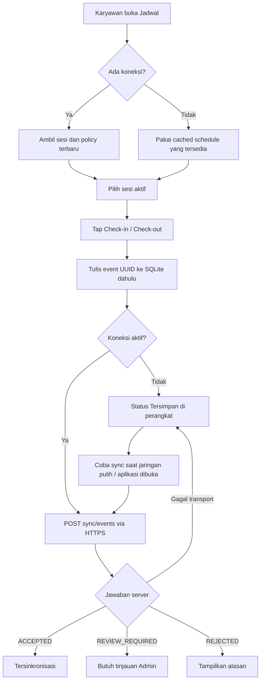

# TECHNICAL IMPLEMENTATION PLAN
## Sistem Absensi & Manajemen Shift — Laravel + Expo (On-Premise)

**Versi:** 1.1 — MySQL edition  
**Tanggal:** 24 Oktober 2026  
**Status:** Implementation baseline, turunan `PRD_Sistem_Absensi_Shift_OnPremise_MYSQL.md` v1.1  
**Target awal:** <50 karyawan, 1 perusahaan/lokasi, 1–4 sesi kerja per tanggal kerja  
**Dokumen otoritatif untuk aturan bisnis:** PRD v1.1; dokumen ini menerjemahkannya menjadi urutan pengerjaan teknis.  
**Prinsip:** YAGNI; satu repository, satu backend, satu MySQL, tidak memakai microservice atau infrastruktur cloud untuk aplikasi/data.

---

## 1. Keputusan arsitektur yang dikunci

| Area | Implementasi | Catatan |
|---|---|---|
| Backend + website admin | Laravel 13 + Blade | Gunakan rilis stabil yang kompatibel dengan server; Laravel 13 membutuhkan PHP >=8.3. Pin versi di lockfile. |
| API mobile | Laravel REST `/api/v1` | Satu codebase dan satu otorisasi server. |
| Database | **MySQL 8.4 LTS (InnoDB)** | Satu database di server fisik klien, migrasi versi terkontrol. |
| Mobile | Expo + React Native + TypeScript | Tombol check-in/out per sesi, tanpa selfie/QR. |
| Mobile offline | `expo-sqlite` | Jadwal cache, event queue persisten, retry idempotent. |
| Penyimpanan token | `expo-secure-store` | Token autentikasi bukan disimpan di SQLite biasa. |
| Auth | Laravel web session + Sanctum mobile token | Login Admin wajib TOTP 2FA. |
| Laporan | Query SQL terindeks + ekspor XLSX/PDF | Job database queue untuk ekspor besar. |
| Background | Laravel database queue + scheduler + systemd | Auto checkout provisional, pekerjaan rekap dan housekeeping. |
| Deployment | Nginx, PHP-FPM, MySQL 8.4, file disk lokal, TLS | Server fisik milik klien, LAN + internet publik. |
| Backup | Manual oleh IT klien | SOP, utilitas backup/restore dan uji pemulihan wajib; tidak membuat backup otomatis tanpa persetujuan. |
| Repository | Monorepo sederhana | Tidak perlu workspace framework tambahan. |

**Boundary:** Website dan API dipublikasikan melalui satu hostname HTTPS jika memungkinkan (`https://absensi.domain-klien.tld`); halaman web `/admin`, API `/api/v1`. MySQL hanya dapat diakses secara lokal/private network. Aplikasi tidak boleh bergantung pada Expo cloud untuk menjalankan backend/data.

**Catatan rilis:** Instalasi aplikasi Android produksi dapat memakai build lokal Android Studio/Expo CLI. `eas build --local` juga tersedia, tetapi tetap melakukan komunikasi tertentu dengan EAS, sehingga bila kebijakan klien benar-benar tanpa dependensi akun pihak ketiga, pilih build native lokal. iOS belum dipastikan termasuk delivery: jangan menjanjikan IPA/distribusi internal iOS tanpa scope signing yang disetujui.

## 2. Struktur repository

```text
attendance-system/
├── server/                     # Laravel: Blade admin + REST API
│   ├── app/
│   │   ├── Http/Controllers/
│   │   │   ├── Admin/         # controller layar admin
│   │   │   └── Api/V1/        # controller JSON versi 1
│   │   ├── Http/Requests/      # validasi input
│   │   ├── Http/Resources/     # response API konsisten
│   │   ├── Models/             # model Eloquent
│   │   ├── Policies/           # hak akses + scope unit kerja
│   │   ├── Actions/            # operasi bisnis lintas tabel
│   │   └── Jobs/               # auto checkout, ekspor, rekap
│   ├── database/migrations/
│   ├── resources/views/admin/
│   ├── routes/{web,api,console}.php
│   └── tests/{Feature,Unit}/
├── mobile/                     # Expo: aplikasi karyawan/supervisor
│   ├── app/                    # expo-router: login, jadwal, absensi, izin
│   ├── src/
│   │   ├── api/                # HTTP client + tipe payload
│   │   ├── db/                 # SQLite queue + cache
│   │   ├── features/           # attendance, shifts, late, overtime
│   │   ├── sync/               # drain queue dan retry
│   │   └── auth/               # token secure-store
│   └── assets/
├── docs/
│   ├── PRD.md
│   ├── TECHNICAL_IMPLEMENTATION_PLAN.md
│   └── api-contract.yaml      # ditulis paling awal, implementasi bertahap
└── README.md
```

Tidak perlu membuat package Laravel terpisah per modul; pengelompokan folder berdasarkan use case cukup. Gunakan **Actions** hanya untuk transaksi bisnis nyata (PublishSchedule, RecordAttendance, VerifyAutoCheckout, ApproveOvertime, FinalizePeriod), bukan untuk setiap CRUD sederhana.

## 3. Invarian bisnis yang tidak boleh dilanggar

1. Satu karyawan hanya punya **satu `shift_assignment` untuk satu `work_date`**, berisi 1–4 `shift_sessions`. Lintas tengah malam tetap memakai tanggal kerja induk.
2. Setiap sesi memiliki pasangan check-in/check-out independen. Total durasi = penjumlahan interval **tervalidasi**, setelah dipotong istirahat tak dibayar, dibatasi jendela kerja dan dihilangkan overlap; jeda antarsesi tidak dihitung.
3. Tipe shift `REGULAR` dan `SPECIAL` menggunakan mesin perhitungan sama; **bukan** asumsi delapan jam sehari.
4. Jam online efektif bersumber dari server; timestamp dari perangkat disimpan sebagai bukti/diagnostik. Event offline disimpan utuh dan ditinjau bila mencurigakan.
5. `event_uuid` unik secara global; pengiriman ulang mengembalikan hasil sebelumnya dan tidak menambah satu sesi lagi.
6. Auto checkout **tidak mengisi `actual_out_at`**; ia hanya mencatat `provisional_out_at`. `verified_minutes` tidak ditambah dari sesi itu sebelum verifikasi Admin.
7. `raw_late_minutes` tetap berdasarkan jam masuk terjadwal (bukan jam setelah toleransi); izin telat yang approved mengubah klasifikasi, **bukan** timestamp asli.
8. `late_permission.create_direct` hanya Super Admin. `attendance_correction.direct` boleh Admin terotorisasi, tetap wajib alasan/audit; keduanya tidak saling mengesahkan otomatis.
9. Perintah lembur hanya dibuat Admin. Otorisasi lembur = approval akhir Admin **dan** consent digital karyawan tercatat di server **sebelum** mulai.
10. Lembur ekstra tanpa perpanjangan yang disahkan sebelum segmen ekstra **tidak diakui**. Waktu reguler dan lembur tidak boleh terhitung dua kali.
11. Tunjangan dihitung dari sesi/jam yang sudah valid. Nominal dan kebijakan harus efektif bertanggal dan disimpan versinya.
12. Periode yang `LOCKED` tidak bisa diubah oleh operasi biasa. Reopen menghasilkan revisi baru dengan jejak audit; snapshot sebelumnya tetap tersedia.
13. Policy yang dipakai pada jadwal/absensi dibekukan sebagai snapshot/version agar rekap historis tidak berubah ketika konfigurasi global diperbarui.
14. Tidak menyimpan data lokasi bila policy `NONE`; bila `RADIUS`, simpan hanya bukti lokasi yang diperlukan beserta akurasi.

## 4. Blueprint database dan urutan migration

**Konvensi MySQL:** `BIGINT UNSIGNED` untuk PK/FK Laravel (`id`/`foreignId`), `DATETIME(6)` untuk waktu kejadian absolut **disimpan sebagai UTC**, `DATE` untuk tanggal kerja lokal, `TIME` untuk jam template, `JSON` untuk metadata fleksibel, `unsignedInteger` untuk durasi menit, `BIGINT` untuk nominal rupiah tanpa pecahan (atau `DECIMAL` bila dibutuhkan). Tetapkan timezone Laravel/koneksi MySQL ke UTC, konversi ke zona kerja (`Asia/Jakarta`) saat rendering/jadwal. MySQL `DATETIME` tidak melakukan konversi zona secara otomatis. **Jangan memakai `TIMESTAMP` untuk timestamp bisnis** karena keterbatasan rentang hingga tahun 2038. Status gunakan `VARCHAR` + validasi aplikasi; UNIQUE dan FK dibuat dalam migration. Semua tabel menggunakan `InnoDB`, `utf8mb4`.

| Urutan | Domain | Migration/tabel utama | Ketergantungan |
|---|---|---|---|
| 01 | Auth & master | `users`, `roles`, `permissions`, pivot RBAC, `departments`, `positions`, `work_locations`, `employees` | Tidak ada |
| 02 | Policy & template | `attendance_policies`, `shift_templates`, `shift_template_sessions` | Master |
| 03 | Jadwal | `shift_assignments`, `shift_sessions` | Employee + template + policy |
| 04 | Absensi | `device_registrations`, `sync_batches`, `attendance_events`, `attendance_records` | Jadwal |
| 05 | Workflow | `attachments`, `late_permissions`, `attendance_corrections`, `approval_steps`, `approval_actions` | Absensi |
| 06 | Lembur | `overtime_orders`, `overtime_consents`, `overtime_events`, `overtime_records` | Employee + approval |
| 07 | Tunjangan & periode | `allowance_types`, `allowance_policies`, `allowance_results`, `attendance_periods`, `period_snapshots` | Semua domain operasional |
| 08 | Audit | `audit_logs` + indeks laporan/performa | Master |

### 4.1 Detail kolom penting

| Tabel | Kolom kunci (selain id/timestamp standar) | Constraint dan index |
|---|---|---|
| `employees` | `user_id?`, `employee_code`, `department_id`, `position_id`, `work_location_id?`, `status` | `employee_code UNIQUE`, `user_id UNIQUE` bila ada |
| `attendance_policies` | `scope_type`, `scope_id?`, `effective_from/to`, `version`, `grace_minutes`, `gps_mode`, `radius_m?`, `accuracy_limit_m?` | Range dan versi efektif tervalidasi |
| `shift_templates` | `name`, `type`, `active` | Type: REGULAR/SPECIAL |
| `shift_template_sessions` | `template_id`, `sequence`, `start_time`, `end_time`, `end_day_offset`, `unpaid_break_minutes` | UNIQUE `(template_id, sequence)` |
| `shift_assignments` | `employee_id`, `work_date`, `template_id?`, `status`, `revision`, `published_at` | UNIQUE `(employee_id, work_date)` |
| `shift_sessions` | `assignment_id`, `sequence`, `start_at`, `end_at`, `policy_snapshot`, `break_intervals?` | UNIQUE `(assignment_id, sequence)`, index waktu |
| `attendance_events` | `event_uuid`, `shift_session_id`, `device_id`, `event_type`, `device_at`, `received_at`, `captured_offline`, `location_payload?`, `validation_flags` | UNIQUE `event_uuid`, INDEX `(shift_session_id, received_at)` |
| `attendance_records` | `shift_session_id`, `in_event_id?`, `out_event_id?`, `actual_in_at?`, `actual_out_at?`, `provisional_out_at?`, `verification_status`, `actual_minutes?`, `verified_minutes` | UNIQUE `shift_session_id`; default verified=0 |
| `late_permissions` | `shift_session_id`, `requester_id?`, `direct_by?`, `allowed_until?`, `allowed_minutes?`, `status`, `reason` | Permission direct diperiksa server |
| `attendance_corrections` | `shift_session_id`, `requester_id`, `applied_by?`, `before_json`, `after_json`, `reason`, `status` | Tidak menimpa raw event |
| `overtime_orders` | `employee_id`, `work_date`, `start_at`, `end_at`, `method`, `planned_minutes`, `status`, `approved_by?`, `approved_at?`, `version` | Cegah overlap tak sah |
| `overtime_consents` | `order_id`, `employee_id`, `accepted`, `consented_at`, `payload_hash`, `device_id?`, `order_version` | Consent terhadap versi spesifik |
| `overtime_records` | `order_id`, `actual_minutes`, `recognized_minutes`, `verified_by?` | Tidak > authorized tanpa extension |
| `allowance_results` | `employee_id`, `work_date`, `type_id`, `policy_version`, `basis_json`, `amount_rp`, `status` | Index `(employee_id, work_date)` |
| `attendance_periods` | `year`, `month`, `status`, `current_revision`, `locked_at?` | UNIQUE `(year, month)` untuk satu perusahaan |
| `period_snapshots` | `period_id`, `revision`, `summary_json`, `checksum`, `generated_by` | UNIQUE `(period_id, revision)` |
| `audit_logs` | `actor_id`, `action`, `subject_type`, `subject_id`, `before_json`, `after_json`, `occurred_at`, `request_id` | append-only, indeks subjek/waktu |

**Catatan mapping:** PRD menyebut opsi `users.employee_id?`. Untuk menghindari FK dua arah, implementasi memakai `employees.user_id?` sebagai relasi akun unik. Secara bisnis sama; tidak perlu mengubah hak akses. `shift_sessions` merepresentasikan jadwal konkret setelah template di-*snapshot*, bukan relasi dinamis yang berubah mengikuti template.

**Transaksi dan race-condition (InnoDB):** Saat publish/ubah jadwal, `DB::transaction()` mengunci `employees` dengan `lockForUpdate()`, kemudian mengecek `shift_sessions` yang overlap termasuk lintas `work_date` sebelum commit. Saat check-in/out, kunci **baris `shift_sessions` yang pasti ada** sebelum membuat/memperbarui projection `attendance_records`, sebab mengunci record yang belum ada tidak melindungi dari race. Unique index `attendance_events.event_uuid` menangani retry/dua request serentak; duplicate-key harus dibaca dan diputuskan apakah payload identik (ACK) atau berbeda (409). MySQL **tidak** menyediakan PostgreSQL exclusion constraint; overlap dijaga dengan row lock + validasi atomik. Transaksi boleh retry 2–3 kali untuk deadlock yang sementara.

### 4.2 Konfigurasi MySQL & migration contoh (pengganti PostgreSQL)

**Persiapan server:** install MySQL 8.4 LTS + ekstensi `pdo_mysql` untuk PHP; gunakan tabel `InnoDB`, `utf8mb4` dengan collation konsisten. Buat database dan user aplikasi berhak akses hanya ke database aplikasi; jangan pakai `root` untuk aplikasi.

```sql
CREATE DATABASE attendance_db CHARACTER SET utf8mb4 COLLATE utf8mb4_0900_ai_ci;
CREATE USER 'attendance_app'@'127.0.0.1' IDENTIFIED BY '<PASSWORD_KUAT_DARI_SECRET_MANAGER>';
GRANT ALL PRIVILEGES ON attendance_db.* TO 'attendance_app'@'127.0.0.1';
```

Catatan: contoh grant ini untuk konfigurasi awal. Pada produksi, pertimbangkan user migration/deploy terpisah dari user runtime dengan hak DML minimal. Contoh akun MySQL dibatasi ke `'127.0.0.1'` agar sesuai `DB_HOST=127.0.0.1`; pastikan cara koneksi TCP lokal dan host matching telah diuji pada server klien. Jangan menyalin placeholder password ke konfigurasi nyata.

**Contoh `.env` Laravel:**

```dotenv
APP_ENV=production
APP_DEBUG=false
APP_TIMEZONE=UTC
DB_CONNECTION=mysql
DB_HOST=127.0.0.1
DB_PORT=3306
DB_DATABASE=attendance_db
DB_USERNAME=attendance_app
DB_PASSWORD=<DIISI_DI_SERVER_BUKAN_DI_GIT>
DB_CHARSET=utf8mb4
DB_COLLATION=utf8mb4_0900_ai_ci
QUEUE_CONNECTION=database
CACHE_STORE=database
SESSION_DRIVER=database
```

Config `config/database.php` memakai koneksi `mysql`, dengan opsi `timezone => '+00:00'` untuk memastikan timezone setiap koneksi UTC (sesuaikan cara konfigurasi versi Laravel yang dipakai). Nilai di atas adalah template, bukan kredensial aktual.

**Contoh migration tabel event & projection:**

```php
Schema::create('attendance_events', function (Blueprint $table) {
    $table->id();
    $table->uuid('event_uuid')->unique();
    $table->foreignId('shift_session_id')->constrained();
    $table->foreignId('device_id')->constrained('device_registrations');
    $table->string('event_type', 20);
    $table->dateTime('device_at', 6);    // UTC dari perangkat, belum tentu tepercaya
    $table->dateTime('received_at', 6);  // UTC dari server
    $table->boolean('captured_offline')->default(false);
    $table->json('location_payload')->nullable();
    $table->json('validation_flags')->nullable();
    $table->index(['shift_session_id', 'received_at']);
});

Schema::create('attendance_records', function (Blueprint $table) {
    $table->id();
    $table->foreignId('shift_session_id')->unique()->constrained();
    $table->dateTime('actual_in_at', 6)->nullable();
    $table->dateTime('actual_out_at', 6)->nullable();
    $table->dateTime('provisional_out_at', 6)->nullable();
    $table->string('verification_status', 24)->default('PENDING');
    $table->unsignedInteger('verified_minutes')->default(0);
});
```

Contoh ini **bukan keseluruhan migration**: foreign keys event check-in/out, metadata tambahan, audit, dan waktu `created_at/updated_at` ditambahkan menurut blueprint. Karena `attendance_events` adalah catatan immutable, gunakan `received_at` sebagai waktu server dan jangan izinkan `update`/`delete` event dari API biasa.

**Transaksi concurrent:**

```php
DB::transaction(function () use ($sessionId) {
    $session = ShiftSession::query()->lockForUpdate()->findOrFail($sessionId);
    // Validasi sesi, insert attendance_event (UNIQUE event_uuid),
    // lalu create/update attendance_records dan audit secara atomik.
}, attempts: 3);
```

Di seluruh path absensi, cek UUID **pada database dengan unique constraint**, bukan hanya `exists()` sebelum insert. Pastikan `attendance_records.shift_session_id` unique, termasuk saat dua event datang bersamaan. Overlap jadwal diperiksa dengan lock induk `employees` sebelum publikasi; tidak ada `EXCLUDE USING gist` pada MySQL. Untuk laporan gunakan indeks B-tree pada kolom normal; jangan mengindeks JSON mentah untuk filter utama.

### 4.3 Ketentuan kompatibilitas

- **Kompatibilitas ORM/API:** Laravel Eloquent, form API, Expo SQLite, role, tunjangan, approval, dan seluruh aturan PRD tidak berubah; yang berubah adalah driver SQL dan detail migration.
- **MySQL bukan MariaDB:** dokumentasi/DDL target adalah Oracle MySQL 8.4. Bila server klien sebenarnya memakai MariaDB, review compatibility dan collation secara terpisah.
- **Audit waktu:** API tetap mengirim ISO 8601 UTC (`...Z`); data MySQL tetap `DATETIME(6)` UTC tanpa zona intrinsik. Pada produksi verifikasi `@@session.time_zone = '+00:00'`, serta uji sesi malam dan DST jika zona lain ditambahkan.
- **Performance:** mulai dari indeks berdasarkan FK/kolom filter laporan; jalankan `EXPLAIN ANALYZE` untuk query rekap yang lambat, bukan membuat indeks di semua kolom.

### 4.4 Migrasi yang jangan dibalik

- Jalankan migrasi 01–03 dan seeder role/permission sebelum implementasi attendance.
- Buat event immutable dan record projection dalam migrasi berbeda/tahap sama; jangan langsung menulis check-in/out ke satu kolom `employees`.
- Buat approval dan audit sebelum membuka fitur koreksi langsung/izin langsung di UI.
- Buat period snapshot hanya setelah mesin kalkulasi durasi dan tunjangan telah memiliki test deterministik.
- Jangan mengubah migration yang telah terpasang di staging/production; tambahkan migration baru.

## 5. Engine inti: proses, status, dan batasan

### 5.1 Schedule Engine

`DRAFT -> PUBLISHED -> IN_PROGRESS -> COMPLETED` (atau `CANCELLED` sebelum ada realisasi). Template dapat di-assign per tanggal dan boleh di-override manual **sebelum** sesi dimulai; perubahan setelahnya melalui koreksi dengan revision/audit.

- Generate sesi timestamp lengkap menurut zona kerja; misalnya `work_date 2026-10-24`, 22:00–06:00 menghasilkan `end_at 2026-10-25 06:00 Asia/Jakarta`.
- Reguler `08:00–17:00` dengan break `12:00–13:00` menghitung 480 menit terjadwal, walau satu check-in/out.
- Khusus `06:00–09:00`, `12:00–15:00`, `18:00–21:00` menghitung 540 menit terjadwal, dengan 3 pasang absensi.
- Validasi maksimum empat sesi, durasi positif, jeda sah, tidak overlap, dan bukan rekaman bulanan terkunci.

### 5.2 Attendance Engine

Alur per event: autentikasi -> otorisasi sesi milik karyawan -> cek status schedule -> cek idempotency UUID -> simpan `attendance_event` mentah -> validasi waktu/lokasi/urutan -> proyeksi record -> keluarkan status API -> audit bila perlu.

Status event server: `ACCEPTED`, `DUPLICATE`, `REVIEW_REQUIRED`, `REJECTED`; status record: `NOT_STARTED`, `IN_PROGRESS`, `COMPLETE`, `PROVISIONAL`, `REVIEW_REQUIRED`, `VERIFIED`, `DISPUTED` (nama final dibekukan dalam API contract).

Jendela checkout tidak boleh salah mengalokasikan event ke sesi tetangga. Raw event disimpan, tetapi `verified_minutes` dihitung hanya dari hasil validasi, dipotong jadwal/break, lalu mencegah double count dengan overtime. Jika user check-in 08:15 dengan grace 10, status terlambat dan `raw_late_minutes=15`. Pembulatan menit dilakukan konsisten pada satu layer service.

**Auto checkout:** job setelah akhir sesi membuat `provisional_out_at=scheduled_end`, record `PROVISIONAL`, `verified_minutes=0` untuk sesi belum diverifikasi. Admin meninjau, mengesahkan durasi efektif atau meminta koreksi. Jika checkout offline asli datang belakangan, jangan menghapus jejak auto checkout; rekonsiliasi dan review bila interval berkonflik.

### 5.3 Approval, izin, koreksi, dan overtime

- Izin terlambat: employee request -> Supervisor/Admin sesuai policy -> approved/rejected. **Direct create** hanya Super Admin.
- Koreksi: employee request -> Admin decide, atau Admin melakukan direct correction dengan alasan dan audit. Direct correction tidak dapat mem-bypass permission direct izin telat.
- Perintah lembur: Admin create -> recommendation opsional -> final Admin approval -> digital employee consent -> `AUTHORIZED`; consent dicatat memakai waktu server dan versi/hashing data perintah; tidak sah jika melebihi waktu mulai.
- Ekstensi lembur = versi/perintah tambahan dengan approval + consent sebelum mulai tambahan. Event overtime ditulis terpisah dari attendance reguler.
- Metode `ACTUAL_CAPPED`: mengakui realisasi valid yang beririsan dengan window disetujui. `PLANNED_CAPPED`: dipilih Admin saat perintah dibuat, memerlukan konfirmasi pelaksanaan dan aturan internal terdefinisi. **Jangan otomatis mengakui durasi rencana yang tidak memiliki bukti pelaksanaan**; apakah boleh melebihi aktual terverifikasi adalah parameter kebijakan/legal yang harus ditandatangani HRD sebelum aktif di produksi.

### 5.4 Periode dan tunjangan

- Laporan mengagregasi menit integer dari tiap sesi valid, overtime recognized, dan tunjangan per `work_date`.
- Tunjangan mempunyai effective date, basis `ALL_SESSIONS`, `MIN_SESSIONS`, `MIN_MINUTES` atau kombinasi; payout `FULL`, `PRORATED_BY_SESSION`, `PRORATED_BY_MINUTES`, `NONE`. `PROVISIONAL` tidak dihitung valid.
- Closing month: verifikasi pending -> preview snapshot -> finalisasi -> period `LOCKED` -> ekspor resmi. Reopen hanya actor berwenang + reason -> revisi berikutnya. Semua impor event yang terlambat setelah lock tetap dapat dicatat sebagai bukti, tetapi perubahan nilai periode harus melewati proses reopen.

## 6. API contract untuk integrasi Expo

**Aturan umum:** versi `/api/v1`; JSON HTTPS; Bearer token untuk mobile, session CSRF untuk web. Aplikasi tidak boleh mengirim `employee_id` sebagai sumber otoritas saat mencatat dirinya sendiri — backend menggunakan user login. List dipaginasi; UTC ISO 8601 untuk API, tanggal kerja `YYYY-MM-DD`. Semua perubahan status kritis idempotent menggunakan UUID/request key.

| Kelompok | Method | Endpoint | Scope |
|---|---|---|---|
| Auth | POST | `/auth/login` | Public + rate limit |
| Auth | POST | `/auth/logout` | Current token |
| Auth | GET | `/me` | Current user |
| Schedule | GET | `/me/schedule?from=YYYY-MM-DD&to=YYYY-MM-DD` | Employee |
| Attendance | POST | `/attendance/events` | Employee |
| Attendance | POST | `/attendance/sync` | Employee, batch offline |
| Attendance | GET | `/attendance/me?from=&to=` | Employee |
| Late | POST | `/late-permissions` | Employee |
| Late | GET | `/late-permissions` | Scope user/team/admin |
| Late | POST | `/late-permissions/{id}/decision` | Delegated approver |
| Late | POST | `/late-permissions/direct` | Super Admin only |
| Correction | POST | `/attendance-corrections` | Employee |
| Correction | POST | `/attendance-corrections/{id}/decision` | Admin |
| Correction | POST | `/attendance/records/{id}/verify` | Admin |
| Overtime | GET | `/overtime/orders` | Employee/Admin |
| Overtime | POST | `/overtime/orders/{id}/consent` | Assigned employee |
| Overtime | POST | `/overtime/events` | Assigned employee |
| Report | GET | `/reports/attendance?from=&to=&employee_id?=` | Authorized scope |
| Report | GET | `/reports/attendance/export?format=xlsx\|pdf` | Authorized scope |
| Period | POST | `/periods/{id}/finalize` | Authorized Admin |
| Period | POST | `/periods/{id}/reopen` | Explicitly authorized actor |

**Endpoint admin untuk membuat shift, perintah lembur, konfigurasi, dan tunjangan** menggunakan `/admin/*` web routes atau `/api/v1/admin/*` bila diperlukan; diputuskan saat membuat layar, tidak menambah endpoint mobile tanpa kebutuhan.

### 6.1 Contoh event attendance

`POST /api/v1/attendance/events`

```json
{
  "event_uuid": "c6c17344-6492-4347-a96a-045e6574f7c5",
  "shift_session_id": 1204,
  "event_type": "CHECK_IN",
  "device_id": "registered-device-uuid",
  "device_at": "2026-10-24T08:15:12+07:00",
  "captured_offline": false,
  "location": null
}
```

Contoh response (HTTP `201` event baru):

```json
{
  "data": {
    "event_uuid": "c6c17344-6492-4347-a96a-045e6574f7c5",
    "status": "ACCEPTED",
    "attendance_record_status": "IN_PROGRESS",
    "server_received_at": "2026-10-24T01:15:13Z"
  }
}
```

- Pengulangan event_uuid + payload identik -> status `DUPLICATE`, referensi event asli, **tanpa side effect**.
- Pengulangan UUID dengan payload berbeda -> HTTP `409 UUID_PAYLOAD_CONFLICT` (jangan menimpa data lama).
- `GPS_RADIUS_REQUIRED` atau lokasi tidak wajar -> simpan event yang dapat diaudit, tetapkan `REVIEW_REQUIRED` atau reject menurut policy yang disetujui. Jika policy `NONE`, tidak meminta/mengirim GPS.
- Jika check-in online, waktu absensi efektif dari **server received time**, bukan `device_at`.

### 6.2 Sync offline batch

`POST /api/v1/attendance/sync`

```json
{
  "batch_uuid": "c04f9021-d3f8-4d52-9f65-2a64b8ab4cda",
  "device_id": "registered-device-uuid",
  "events": [
    {
      "event_uuid": "35cb2382-1bea-483a-98ca-9492f91c0f81",
      "shift_session_id": 1204,
      "event_type": "CHECK_OUT",
      "device_at": "2026-10-24T17:02:00+07:00",
      "captured_offline": true,
      "local_sequence": 18,
      "location": null
    }
  ]
}
```

Response `200`: hasil per event, misalnya:

```json
{
  "batch_uuid": "c04f9021-d3f8-4d52-9f65-2a64b8ab4cda",
  "results": [
    {"event_uuid": "35cb2382-1bea-483a-98ca-9492f91c0f81", "status": "REVIEW_REQUIRED", "reason_code": "OFFLINE_CLOCK_UNVERIFIED"}
  ],
  "server_time": "2026-10-24T10:08:10Z"
}
```

**Protokol:** Satu response per UUID; keberhasilan sebagian tidak menggagalkan batch lainnya; Mobile baru menandai event `SYNCED` sesudah menerima ACK per event dari server. Event `REVIEW_REQUIRED` sudah tersimpan di server sehingga tidak perlu retry terus-menerus; event `REJECTED` ditampilkan bersama alasannya. Kegagalan jaringan/5xx diretry dengan backoff, UUID tetap sama. Event offline dari jadwal yang sudah diubah/dibatalkan atau dari periode `LOCKED` harus ditandai untuk review, tidak langsung diposting sebagai nilai rekap final.

**Response errors (disepakati sebelum coding):** `401 UNAUTHENTICATED`, `403 FORBIDDEN`, `409 STATE_CONFLICT`, `422 VALIDATION_ERROR`, `429 RATE_LIMITED`, `503 SERVICE_UNAVAILABLE` dengan `code`, `message`, `details?`, dan `request_id` stabil. Tidak membocorkan stack trace ke mobile.

## 7. Mekanisme offline Expo yang harus diimplementasikan

### 7.1 Data lokal minimal

| SQLite table | Tujuan | Penyimpanan |
|---|---|---|
| `schedule_cache` | Sesi, work_date, window, snapshot aturan | diperbarui saat online |
| `pending_attendance_events` | `event_uuid`, `session_id`, tipe, waktu device, sequence, GPS opsional, status sync | persisten sampai ACK |
| `sync_state` | batch terakhir, last successful sync, metadata versi jadwal | lokal |

Token disimpan di SecureStore, **bukan** tabel SQLite. Jangan simpan data karyawan lain di cache. Bersihkan cache sensitif ketika logout yang berhasil; jika masih ada event belum tersinkron, minta penyelesaian/panduan sebelum menghapus agar bukti tidak hilang. Tentukan retensi dan backup mobile saat UAT.

### 7.2 Alur mobile offline



**Batasan yang wajib dijelaskan di UI:** Timestamp perangkat offline bukan bukti waktu yang anti-manipulasi; jika belum pernah login/sinkronisasi jadwal, aplikasi tidak boleh membuat event untuk sesi yang tidak dikenal. Izin dan consent lembur **tidak bisa disahkan offline**; tampilan boleh read-only saat disconnected. Revisi jadwal yang diterbitkan ketika karyawan offline akan diperiksa server saat sync. Metode validasi GPS dapat diaktif/nonaktifkan per policy. Status keberhasilan sync tidak sama dengan validasi jam kerja.

## 8. Modul & pembagian tugas developer

| Modul | Backend + Web (Dev A) | Expo (Dev B) | Syarat selesai |
|---|---|---|---|
| M01 Auth/RBAC | Login, TOTP 2FA, permission, role/department scope | Login, logout, device token | Auth test & forbidden 403 |
| M02 Master | Employee, positions, departments, work locations | Profil diri | Master bisa diubah dan diaudit |
| M03 Shift | Template, calendar, publish, overlap validation | Schedule timeline + cache | Reguler/khusus/night shift diuji |
| M04 Attendance | Raw event, projection, idempotency, API sync | Check-in/out, SQLite queue & retry | Offline UAT, UUID duplicate |
| M05 Policy | Global/dept/employee override + snapshot | UI GPS optional + grace status | Rule test 08:15/10m |
| M06 Late | Form admin/approval/direct by Super Admin | Request + status | Admin biasa tidak bisa direct |
| M07 Correction | Corrections, auto checkout verification, audit | Request correction | Jam provisional tidak final |
| M08 Overtime | Admin order, approval chain, consent proof, realized/recognized minutes | Order view + digital consent + event | Consent sebelum start |
| M09 Allowance | Rules, calculation + detail penjelasan | Lihat ringkasan diri (opsional UI) | Per sesi/jam dan prorata diuji |
| M10 Reports | Dashboard, Excel/PDF, period lock/revision | Lihat riwayat sendiri | Agregat & ekspor konsisten |
| M11 Ops | Logs, metrics, release, backup SOP | APK signed + config endpoint | On-prem UAT dan restore test |

**Ownership tegas:** Dev A owns MySQL migrations, domain business rules, `docs/api-contract.yaml`, security, dan end-to-end data integrity. Dev B owns Expo UI, local database/queue, network transitions, dan UX status. QA/PM (dapat dirangkap) owns UAT, traceability, dan penerimaan klien. Keputusan bisnis tidak boleh dibuat sepihak saat implementasi; catat `[TBD]` di decision log.

### Dependency agar kerja bisa paralel

1. Hari awal: Dev A dan Dev B menyepakati `api-contract.yaml`, daftar status/error, serta contoh JSON.
2. Dev A mulai M01–M03 dan menyiapkan seed demonstrasi 1 reguler, 2 sesi, 3 sesi, dan shift malam.
3. Dev B membuat layar dan antrian offline memakai mocked response dari kontrak; jangan menunggu API selesai.
4. Integrasikan `GET /me/schedule` dan `POST /attendance/sync` sedini mungkin di staging.
5. Approval, lembur, allowance, report baru dikembangkan setelah event engine dan interval math lulus test.
6. Gunakan satu board issue GitHub, tiap issue mereferensi modul dan ID UAT PRD.

## 9. Git workflow anti konflik (untuk 2 developer)

- Branch `main` = releasable; fitur lewat `feature/M03-shift-assignment`, `feature/M04-offline-sync`, dst.
- Pull request kecil, tiap PR satu fitur/bug. Wajib minimal 1 reviewer, pipeline test hijau, dan tidak memuat secrets.
- **Migration ownership Dev A**; perubahan skema yang dibutuhkan Dev B diajukan sebagai issue/PR review, bukan dibuat langsung di branch mobile.
- `composer.lock` dan `package-lock.json` (atau package manager yang dipilih) committed. Jangan mengganti versi dependency diam-diam.
- Jangan force-push ke `main`, jangan edit migration lama yang sudah deployed, jangan mengubah API response tanpa memperbarui contract/consumer.
- Squash merge boleh; tag tiap milestone `v0.1.0`, `v0.2.0`, hingga `v1.0.0`.
- Setiap PR minimal berisi: modul/issue, perubahan DB/API, cara tes, hasil tes, screenshot UI jika ada.
- Rahasia server hanya ada di `.env` server, tidak di repository. Expo public config hanya menyimpan `API_BASE_URL`, **bukan** credentials atau database password.

## 10. Roadmap implementasi dan gerbang penerimaan

**Estimasi kasar:** ±12–16 minggu untuk **2 developer penuh waktu + QA/PM paruh waktu**, diasumsikan scope sesuai PRD, Android sebagai target awal, hardware on-prem siap, tidak ada integrasi payroll penuh. Bukan janji kontraktual; kalibrasi setelah validasi mockup dan spesifikasi server.

| Tahap | Estimasi | Output | Gate (harus lulus sebelum lanjut) |
|---|---|---|---|
| S0 Kontrak & fondasi | 1 minggu | repo, CI minimum, API contract, role, env staging | Login dan schema awal berjalan |
| S1 M01–M03 | 2–3 minggu | users/roles, employee, policy, shift calendar/publish | Shift 1–4 sesi, overnight dan overlap lulus |
| S2 M04–M05 | 3–4 minggu | absensi Expo, offline sync, raw event, policies | duplicate/offline/GPS/auto provisional lulus |
| S3 M06–M08 | 2–3 minggu | izin, koreksi, approval, perintah & consent lembur | permission dan integritas durasi lulus |
| S4 M09–M10 | 2–3 minggu | tunjangan, dashboard, Excel/PDF, period lock | agregat dan snapshot/revision konsisten |
| S5 M11 Go-live | 2 minggu | hardening, deployment, signed APK, backup manual & UAT | 24 UAT PRD dan restore test disetujui |

Milestone praktis untuk invoicing/acceptance dapat dipetakan ke S1, S2–S3, S4–S5, tetapi termin keuangan tidak ditetapkan di dokumen ini.

## 11. Test strategy wajib

### Unit (Laravel)
- Kalkulasi interval: check-in telat, check-out awal, break tak dibayar, shift lintas tanggal, 2–4 sesi, interval overlap, pembulatan menit.
- Override policy `INDIVIDUAL > DEPARTMENT > GLOBAL` dengan snapshot efektif.
- Lembur `ACTUAL_CAPPED`, `PLANNED_CAPPED` dengan pelaksanaan diverifikasi, overlap shift, extension.
- Eligibility tunjangan: FULL, prorata sesi/jam, NONE; sesi provisional = 0 valid.

### Feature/API (Laravel)
- Login, TOTP 2FA untuk role Admin, scope departemen; employee A akses employee B harus 403.
- UUID duplikat dan UUID payload berbeda, retry, out-of-order, event schedule berubah.
- Auto checkout provisional; verifikasi manual mengubah `verified_minutes` dan menjaga raw event.
- Direct late permission hanya Super Admin; direct correction Admin tetap memiliki audit.
- Consent lembur lebih lambat dari start = tidak authorized; extension tanpa consent/approval = tidak diakui.
- Setelah periode lock: write reguler ditolak; reopen dengan alasan dan revision snapshot.

### Mobile & integrasi
- App offline saat check-in, app restart, 2–3 event queued, reconnect, upload sekali.
- Perpindahan Wi-Fi LAN ke mobile internet HTTPS tanpa mengganti akun/jadwal.
- GPS mode `NONE` tidak meminta izin, mode `RADIUS` meminta izin dan mengirim akurasi.
- Loss of token/revocation saat offline memunculkan kebutuhan login tanpa membuang bukti lokal tanpa konfirmasi.
- Clock perangkat sengaja dimajukan/dimundurkan menimbulkan review; tidak ada klaim anti-fraud mutlak.

### UAT & load
- Gunakan **UAT-01 s.d. UAT-24 dalam PRD** sebagai acceptance resmi (hindari daftar acceptance baru yang berbeda).
- Uji 50 akun aktif dan burst absensi serentak sesuai kapasitas aktual server. Ukur respons API dan query, bukan target performa buatan.
- Uji restore manual pada staging, termasuk attachment dan konfigurasi penting.

## 12. Deployment on-premise: langkah konkret

### 12.1 Prasyarat yang harus diperiksa IT klien

- CPU/RAM/SSD dan OS server yang terpasang, ruang bebas disk untuk DB/file/backup; UPS/power, waktu server NTP.
- IP publik **benar-benar routable** (bukan sekadar internet kantor di belakang CGNAT), router/NAT, port HTTPS 443, DNS domain/subdomain, sertifikat TLS.
- Firewall hanya expose HTTPS, akses SSH lewat VPN/allowlist; **MySQL TCP 3306 tidak publik**.
- DNS internal/split-horizon agar hostname HTTPS sama saat Wi-Fi kantor maupun internet luar.
- Media backup **fisik terpisah** dan orang penanggung jawab backup/restore manual.
- User deploy terpisah dari root, akses vendor terbatas, daftar perangkat untuk UAT.

### 12.2 Layout runtime server

```text
Internet/LAN -> Firewall/HTTPS 443 -> Nginx -> Laravel public/index.php
                                           |-- web admin (/admin)
                                           +-- API mobile (/api/v1)
                                    PHP-FPM + cron + systemd queue worker
                                      |-- MySQL (loopback/private)
                                      +-- local storage (protected)
```

- Set `.env` produksi: `APP_ENV=production`, `APP_DEBUG=false`, `APP_TIMEZONE=UTC`, URL resmi, `DB_CONNECTION=mysql`, `DB_HOST=127.0.0.1`, `DB_PORT=3306`, user DB non-root, `QUEUE_CONNECTION=database`, storage private. Zona bisnis `Asia/Jakarta` dikonfigurasi terpisah.
- Jalankan migration `--force` dalam window release yang disetujui setelah backup; seeder produksi hanya untuk roles/permission/admin bootstrap (bukan data demo).
- Cache config/routes/views sesuai rilis; worker di-restart/reload tiap deploy, scheduler cron diset per menit, uji health route dan sertifikat TLS.
- Susun monitoring ringan untuk disk space, queue failed jobs, error logs, dan backlog offline review.
- Distribusi APK signed internal lewat kanal klien. Kelola signing key di lokasi aman; dokumentasikan cara update aplikasi tanpa kehilangan SQLite event queue.

### 12.3 Manual backup & restore (sesuai keputusan klien)

Runbook harus menjelaskan backup **MySQL** menggunakan `mysqldump --single-transaction --quick`, file attachment/storage privat, versi release/migration, dan secret kritis seperti `APP_KEY` (disimpan terpisah terenkripsi), serta verifikasi checksum dan uji restore pada lingkungan aman. Jangan memasukkan password ke shell history/log. Karena hanya manual, **RPO = sejak backup terakhir** dan administrator klien harus menerima risiko kehilangan data bila backup terlambat. Vendor dapat memberi checklist pengingat tanpa menjalankan backup otomatis.


**Contoh SOP manual (operator IT klien):**

```bash
# Backup MySQL yang konsisten untuk tabel InnoDB; berkas credential hanya readable oleh operator.
set -o pipefail
mysqldump --defaults-extra-file=/etc/attendance/mysql-backup.cnf \
  --single-transaction --quick --routines --triggers --events \
  --set-gtid-purged=OFF attendance_db | gzip > attendance-db-YYYYMMDD.sql.gz
sha256sum attendance-db-YYYYMMDD.sql.gz > attendance-db-YYYYMMDD.sql.gz.sha256

# Uji restore hanya pada database staging yang dipersiapkan terpisah.
gunzip -c attendance-db-YYYYMMDD.sql.gz | \
  mysql --defaults-extra-file=/etc/attendance/mysql-restore.cnf attendance_restore_test
```

Jalankan dengan `set -o pipefail` bila menggunakan Bash agar kegagalan `mysqldump` tidak menghasilkan file gzip kosong yang dikira berhasil. File `/etc/attendance/mysql-*.cnf` harus dimiliki operator IT, permission `0600`, dan tidak masuk repository. `mysqldump`/`mysql` membaca file konfigurasi `--defaults-extra-file` sebagai **opsi pertama**. Jalankan hanya sesudah memastikan user DB berhak dump dan restore; contoh restore mengasumsikan database `attendance_restore_test` sudah dibuat. Salin pula file attachment privat (beserta permission/ownership), konfigurasi deployment, dan rahasia penting secara terpisah dan terenkripsi. Simpan media fisik cadangan terpisah, verifikasi checksum, dan uji pemulihan dalam jadwal SOP manual yang disepakati.

### 12.4 Checklist go-live

- [ ] Server, CPU/RAM/disk/OS diverifikasi; waktu server benar.
- [ ] Hostname HTTPS aktif dari LAN & internet publik.
- [ ] **MySQL 3306** dan port admin tidak terekspos internet.
- [ ] 2FA Admin dan role/scope API diuji.
- [ ] 1–4 sesi, shift malam, grace, izin, dan koreksi diuji.
- [ ] Offline queue/retry/duplicate/anomaly diuji di perangkat nyata.
- [ ] Approval admin + consent employee lembur diuji.
- [ ] Auto checkout provisional tidak masuk jam tervalidasi sebelum review.
- [ ] Aturan tunjangan disahkan HRD dan hasil ekspor identik dengan dashboard.
- [ ] Finalisasi/reopen periode dan audit revision diuji.
- [ ] Backup manual lengkap dan restore test berhasil.
- [ ] Pengujian transaksi simultan MySQL InnoDB: UUID duplikat, payload konflik, dua check-in serentak, deadlock retry.
- [ ] Uji `DATETIME(6)` UTC, shift lintas hari, dan koneksi `@@session.time_zone`.
- [ ] `mysqldump` + restore file attachment di lingkungan staging teruji.
- [ ] Staf HRD, karyawan, dan IT menerima panduan serta akses minimum yang sesuai.
- [ ] 24 skenario UAT dari PRD mendapatkan keputusan penerimaan.

## 13. Config/TBD yang harus diputuskan sebelum UAT final

1. Default grace, jam check-in paling awal, batas pengajuan izin terlambat, aturan lokasi radius/akurasi.
2. Batas maksimum penyimpanan offline, waktu drift yang perlu ditinjau, dan perlakuan terhadap schedule update saat offline.
3. Jam istirahat reguler dan aturan kerja lintas hari, kebijakan legal lembur/hari libur.
4. Formula tunjangan, minimum jumlah sesi/jam, nominal, prorata dan pembulatan.
5. Metode `PLANNED_CAPPED` yang dapat dipertanggungjawabkan; realisasi tetap tercatat.
6. Matrik delegasi Supervisor/Admin, otorisasi reopen rekap, kebijakan self-approval.
7. Target perangkat produksi Android/iOS dan skema distribusi/signing.
8. Domain HTTPS, konfigurasi LAN, spesifikasi server, storage backup dan SLA dukungan vendor.
9. Retensi data dan hak akses bukti GPS/attachment.

**Aturan perubahan:** Keputusan parameter cukup direkam sebagai konfigurasi berversi. Jika ada perubahan yang menambah fitur atau mengubah acceptance PRD, buat change request, jangan diam-diam menyisipkan scope baru.

## 14. Definition of Done per modul

Sebuah modul dianggap selesai **hanya jika**: migrasi aman, validasi/permission backend diterapkan, test lulus, contoh request/response cocok dengan API contract, UI menyampaikan status/error benar, audit kritis ada, dan UAT terkait bisa direproduksi. Selesai coding ≠ selesai modul.

## 15. Referensi resmi (dicek 24 Oktober 2026)

- Laravel deployment/server PHP requirements: https://laravel.com/docs/13.x/deployment
- Laravel dukungan MySQL: https://laravel.com/docs/13.x/database
- Laravel migrations & JSON: https://laravel.com/docs/13.x/migrations
- MySQL 8.4 JSON: https://dev.mysql.com/doc/refman/8.4/en/json.html
- MySQL 8.4 InnoDB locking: https://dev.mysql.com/doc/refman/8.4/en/internal-locking.html
- MySQL 8.4 mysqldump: https://dev.mysql.com/doc/refman/8.4/en/mysqldump.html
- Laravel Sanctum mobile authentication: https://laravel.com/docs/13.x/sanctum
- Laravel scheduler: https://laravel.com/docs/13.x/scheduling
- Expo SQLite: https://docs.expo.dev/versions/latest/sdk/sqlite/
- Expo SecureStore: https://docs.expo.dev/versions/latest/sdk/securestore/
- Expo local builds: https://docs.expo.dev/build-reference/local-builds/
- Expo local native compilation: https://docs.expo.dev/develop/development-builds/introduction/

---

**Rekomendasi keputusan eksekusi:** Mulai dari `api-contract.yaml` + database migration 01–03, lalu bangun `Attendance Engine` dengan raw immutable events dan idempotency sebelum membuat tampilan absensi yang final. Ini adalah komponen berisiko tertinggi; laporan dan tunjangan akan benar hanya bila fondasi ini konsisten.
